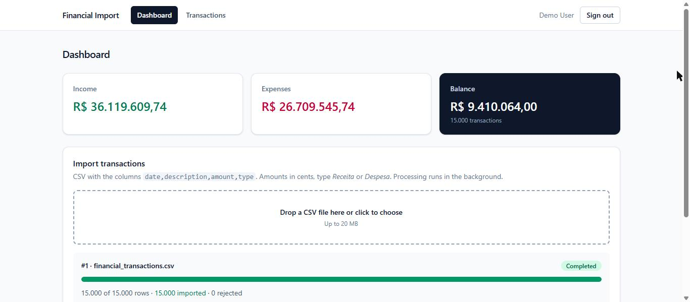
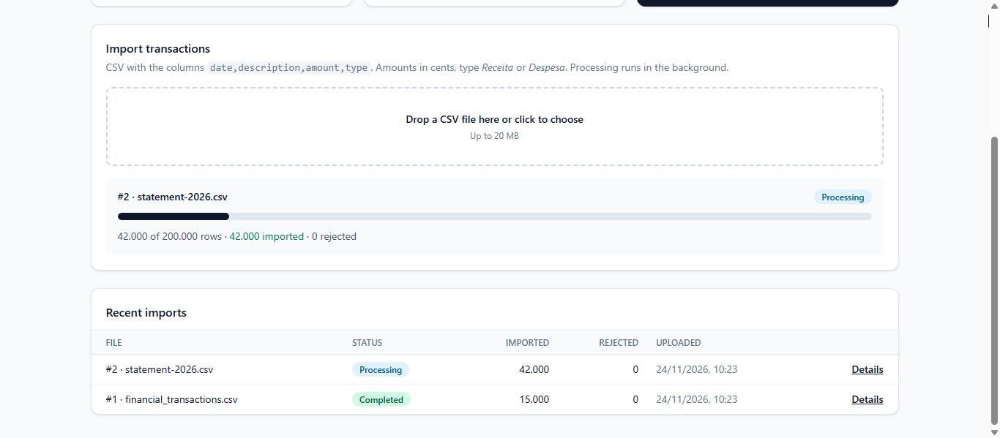
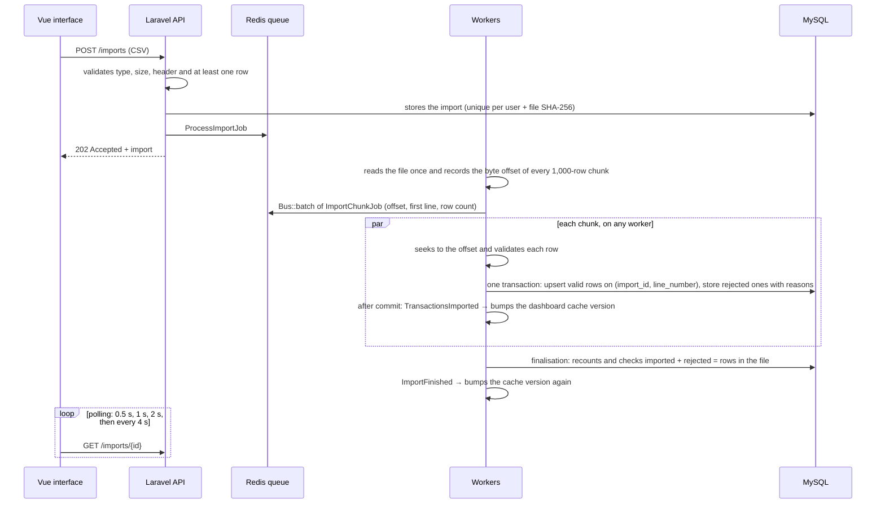

# Financial Import

**English** · [Versão em português](README.md)

[](https://github.com/filipelira1/financial-import/actions/workflows/ci.yml)

Import and track financial transactions from CSV files. The user uploads one or more files, the import
runs in the background with progress on screen, and the dashboard shows income, expenses, balance and
the month-by-month trend. Bad rows don't block the file: they are kept with the reason, so they can be
fixed and sent again.

| Dashboard with totals and the monthly chart | An import of 200,000 rows in progress |
|---|---|
|  |  |

## Features

- **Background import:** the upload answers at once and the queue processes the file in parallel chunks.
  The progress bar follows each chunk.
- **Several files at once:** up to 10 per upload, each becoming its own import, with the result shown file
  by file. The same file sent twice is refused, with a link to the earlier import.
- **Rejected rows with the reason:** listed on screen and downloadable as CSV, with the line number, the
  reasons and the original content.
- **Dashboard:** income, expenses and balance, plus a chart of income and expenses per month. All served
  from the cache and refreshed when new transactions arrive.
- **Transactions:** paginated list filtered by type, by period and by a search on the description. The
  search ignores case and accents.
- **Export:** the filtered list as CSV in the same format as the import, so an exported file can be
  imported again.
- **Portuguese and English:** the interface and API messages follow the language picked at the top.
- **Authenticated access:** the API and the interface only answer users with a valid token.

## Stack

| Layer | Technology |
|---|---|
| API | PHP 8.4, Laravel 13, Sanctum (Bearer tokens), Scramble (OpenAPI generated from the code) |
| Queue and cache | Redis 7.4, Laravel `Bus::batch` |
| Database | MySQL 8.4 |
| Interface | Vue 3, TypeScript, Vite, Pinia, Vue Router, Tailwind CSS 4 |
| Tests | Pest (backend, on real MySQL and Redis), Vitest (frontend), shell end-to-end test |
| Environment | Docker Compose: nginx, PHP-FPM, queue worker, scheduler, MySQL and Redis |
| CI | GitHub Actions: backend, frontend and the full stack started from scratch |

---

## Contents

1. [Running it](#running-it)
2. [Tests](#tests)
3. [Architecture](#architecture)
4. [CSV format](#csv-format)
5. [API](#api)
6. [Technical decisions](#technical-decisions)
7. [Measured performance](#measured-performance)
8. [Limits and next steps](#limits-and-next-steps)
9. [Troubleshooting](#troubleshooting)

---

## Running it

**Requirements:** Docker with Compose v2. `make` is optional. Ports **8090** and **127.0.0.1:33070** must be free.

```bash
git clone https://github.com/filipelira1/financial-import.git
cd financial-import
make up
```

Without `make`:

```bash
HOST_UID=$(id -u) HOST_GID=$(id -g) docker compose up -d --build --wait
```

The first start builds the images, installs dependencies, runs the migrations and creates the demo user.
On a clean machine it takes about 3 minutes; later starts take seconds. Then:

1. Open <http://localhost:8090> and sign in with **`demo@example.com` / `password`**.
2. Drop the sample file [`backend/tests/fixtures/financial_transactions.csv`](backend/tests/fixtures/financial_transactions.csv)
   (15,000 transactions) on the upload area.
3. Watch the progress bar. The dashboard ends at **income R$ 36,119,609.74**,
   **expenses R$ 26,709,545.74** and **balance R$ 9,410,064.00**.

| Command | What it does |
|---|---|
| `make help` | Lists every shortcut. |
| `make down` | Stops the stack. |
| `make fresh` | Empties the database, keeping the demo user. |
| `make logs` | Follows the API and worker logs. |
| `make docs` | Regenerates `docs/openapi.json`. |

## Tests

| Command | What runs |
|---|---|
| `make test` | **Backend:** Pest on MySQL 8.4 (separate `financial_import_test` schema) and Redis (database 15). Unit, feature, architecture and an acceptance test that imports the sample file and checks the totals. |
| `make test-frontend` | **Frontend:** type-check and Vitest in a throwaway Node container (no Node.js needed on the machine). With Node 22 installed: `cd frontend && npm ci && npm test`. |
| `make smoke` | **End to end, against the running stack:** signs in, imports the sample file through the API, waits for the queue and compares the dashboard with the expected totals. |
| `make lint` | Pint (code style). |

[GitHub Actions](.github/workflows/ci.yml) runs on every push:
- **backend:** Pint, Pest with MySQL and Redis services, and a check that `docs/openapi.json` matches the code;
- **frontend:** type-check, Vitest and the production build;
- **stack:** `docker compose up` from scratch, followed by the end-to-end test.

## Architecture

### Services

| Service | Role |
|---|---|
| `nginx` | Serves the interface (built inside the image) and forwards `/api`, `/docs` and `/up` to PHP. Port **8090**. |
| `app` | PHP-FPM 8.4 with Laravel 13. On start it installs dependencies, runs migrations and the seeder. |
| `worker` | `queue:work` on Redis, `imports` queue first. Scale with `docker compose up -d --scale worker=3`. |
| `scheduler` | `schedule:work`: prunes expired tokens, recovers stuck imports and discards failed imports that were never retried. |
| `mysql` | Application data and the test schema. Exposed only on `127.0.0.1:33070`. |
| `redis` | Queue, cache, rate limits and locks. Not exposed. |

### How an import works



### Code layers

```
backend/app
├── Domain/                 plain PHP, no framework
│   ├── Finance/            TransactionType, TransactionData, FinancialSummary (the balance rule),
│   │                       TransactionRepository (port), TransactionsImported event
│   └── Import/             ImportStatus, TransactionRowParser (row validation), RowRejection,
│                           ImportFinished event
├── Application/            use cases (Actions)
│   ├── Import/             StartImport, PlanImport, ImportChunk, FinalizeImport, RetryImport,
│   │                       RecoverStuckImports, DiscardFailedImports
│   └── Finance/            GetDashboardSummary, GetMonthlySummary, ListTransactions,
│                           ExportTransactions, TransactionFilters
├── Infrastructure/         CsvReader (streaming reads, byte offsets), DbTransactionRepository
│                           (bulk upsert, sums), DashboardSummaryCache (versioned keys)
├── Http/                   thin controllers, FormRequests, API Resources, CsvDownload,
│                           ReasonTranslator, locale middleware
├── Jobs/                   ProcessImportJob (plans and fans out), ImportChunkJob (one chunk)
├── Listeners/, Observers/  dashboard cache invalidation
└── Models/                 Eloquent models (persistence)

frontend/src
├── api/                    fetch client (Bearer, typed errors, downloads), API routes
├── composables/            usePolling (back-off), useImportTracker
├── stores/                 session (Pinia)
├── components/, views/     dashboard, monthly chart, upload area, transactions
├── i18n/                   typed Portuguese and English dictionary
└── types/api.ts            the API contract (mirrors the Laravel Resources)
```

Architecture tests (Pest `arch()`, in [`ArchitectureTest`](backend/tests/Unit/ArchitectureTest.php))
keep four rules:
- the domain uses nothing from Laravel, the models, HTTP or infrastructure;
- domain events and data objects are `final readonly`;
- use cases know nothing about HTTP;
- controllers don't query or dispatch jobs.

### Design patterns

| Pattern | Where | Why here |
|---|---|---|
| **Action / use case** | `app/Application/*Action.php` | One class per use case. Controllers, jobs and commands only translate input and call the Action, so one use case serves HTTP, the queue and the CLI. |
| **Repository (port and adapter)** | Port: `Domain/Finance/Contracts/TransactionRepository`; adapter: `Infrastructure/Persistence/DbTransactionRepository` | Only where the query is the point: the bulk upsert and the sums. Simple reads use Eloquent directly. |
| **Domain event + listener** | `TransactionsImported`, `ImportFinished` → `InvalidateDashboardSummary` | The bulk upsert bypasses Eloquent, so a model observer never sees imported rows. The import announces them. |
| **Observer** | `TransactionObserver` | Covers transactions saved one by one through Eloquent (seeder, tinker, a future manual entry). |
| **DTO / Value Object** | `TransactionData`, `FinancialSummary`, `CsvChunk`, `TransactionFilters` | Immutable (`final readonly`): validity is checked once, in the constructor. |
| **Enum** | `TransactionType`, `ImportStatus` | Closed sets of values, cast on the models and enforced by `CHECK` constraints. |
| **Batch / fan-out** | `ProcessImportJob` → `Bus::batch(ImportChunkJob…)` → `finally` | Parallel chunks with progress and a single finalisation step. |

## CSV format

- **Header:** `date`, `description`, `amount` and `type`, in any order and any case. Extra columns are ignored.
- **File:** UTF-8 or Windows-1252; comma, semicolon or tab separator; BOM and CRLF accepted; up to 20 MB.
- **`date`:** `YYYY-MM-DD`, a real calendar date (`2025-02-30` is rejected).
- **`description`:** required, up to 255 characters.
- **`amount`:** **positive integer in cents**. `-500`, `1.234,56` and `12.5` are rejected rather than guessed.
- **`type`:** `Receita` or `Despesa` (also `income` / `expense`), any case.
- **Blank lines** are skipped. Line numbers are the file's, with the header on line 1.
- **Invalid rows** don't stop the import: valid rows are stored, each rejected one is kept with every
  reason, and the import ends as `completed_with_errors`.
- **The same file** (same SHA-256) sent again by the same user answers **409**.

Import states: `pending` → `processing` → `completed` | `completed_with_errors` | `failed`.

## API

Every route lives under `/api/v1`, answers JSON and, except login, requires `Authorization: Bearer <token>`.
- **Interactive docs**, generated from the code: **<http://localhost:8090/docs/api>** (with `APP_ENV=local`,
  the `.env.example` default).
- **The OpenAPI document** is in [`docs/openapi.json`](docs/openapi.json), ready for Postman or Insomnia.
  CI checks that it matches the code.

| Method | Path | Description |
|---|---|---|
| `POST` | `/auth/login` | Email and password for a token (expires in 8 h). Rate-limited per account and per IP. |
| `POST` | `/auth/logout` | Revokes the current token. |
| `GET` | `/auth/me` | The authenticated user. |
| `POST` | `/imports` | Uploads a CSV (`multipart/form-data`, field `file`). **202** at once with the import; **409** if the file was already sent; **422** for a wrong file or header. |
| `GET` | `/imports` | The user's imports, newest first. |
| `GET` | `/imports/{id}` | State and progress (`progress` 0 to 100, `is_finished`). |
| `GET` | `/imports/{id}/failures` | Rejected rows: line number, content and reasons in the requested language. |
| `GET` | `/imports/{id}/failures/export` | The same rejected rows as CSV. |
| `POST` | `/imports/{id}/retry` | Re-runs a failed import (**409** if it didn't fail). Rows already stored aren't duplicated. |
| `GET` | `/dashboard/summary` | `income_cents`, `expense_cents`, `balance_cents`, `transaction_count` (cached). |
| `GET` | `/dashboard/monthly` | The same totals per month (`YYYY-MM`), oldest first (cached). |
| `GET` | `/transactions` | Paginated list, newest first. Filters: `type`, `from`, `to` (`YYYY-MM-DD`), `q` (part of the description), `per_page` (5 to 100), `page`. |
| `GET` | `/transactions/export` | The transactions for the same filters as CSV, in the import format. |

Another user's import answers **404**, like one that doesn't exist. **Amounts are integer cents**
(`115346` = R$ 1,153.46).

```bash
TOKEN=$(curl -s -X POST localhost:8090/api/v1/auth/login -H 'Content-Type: application/json' \
  -d '{"email":"demo@example.com","password":"password"}' | jq -r .data.token)

curl -s -X POST localhost:8090/api/v1/imports -H "Authorization: Bearer $TOKEN" -H 'Accept: application/json' \
  -F file=@backend/tests/fixtures/financial_transactions.csv
curl -s localhost:8090/api/v1/dashboard/summary -H "Authorization: Bearer $TOKEN"
```

## Technical decisions

**1. Money is an integer number of cents.**
- **Decision:** an always-positive `BIGINT`. The sign comes from `type`, and the balance rule
  (`income − expenses`) lives in one place, [`FinancialSummary`](backend/app/Domain/Finance/FinancialSummary.php).
- **Why:** floats lose cents, and a signed amount leaves room for an expense to count as income.
- **Database guard:** `CHECK (type IN ('income','expense'))` and `CHECK (amount_cents > 0)`.

**2. The queue carries an address, not the data.**
- **Decision:** `ProcessImportJob` reads the file once and records the byte offset where each 1,000-row chunk
  starts. Each `ImportChunkJob` seeks straight there.
- **Why:** Redis holds three numbers per job, and worker memory is the same for 15 thousand or 15 million
  rows. More workers mean more chunks in parallel.

**3. Idempotency at two levels.**
- **File:** unique index on `(user_id, file_hash)`. Two identical uploads at the same time are settled by the
  database, and the second gets 409.
- **Row:** unique index on `(import_id, line_number)` plus upsert. The queue delivers at least once, so a chunk
  that runs twice stores nothing new, and counters only grow with rows actually stored.
- **Why not `INSERT IGNORE`:** on MySQL it would also turn real errors (truncation, `CHECK`, foreign key)
  into mere warnings.

**4. Partial import with a report, plus a count check.**
- **Decision:** a bad row becomes a reported rejection, not a failed file. At the end the import is recounted
  from the tables and only completes if `imported + rejected = rows in the file`. If not, it fails with the
  reason and can be retried without duplicates.
- **Why:** refusing 14,999 good rows because of one bad row wastes the user's work.

**5. Dashboard cache with a versioned key.**
- **Decision:** the key is `dashboard:summary:{user}:v{version}`, and invalidating means bumping the version.
  The monthly chart uses the same version, so both refresh together.
- **Why not delete the key:** a read that started before an import's commit could write the old totals right
  after the delete. With a version, that late write lands on a key nobody reads.
- **What invalidates:** the domain events and the observer. A one-hour TTL as a safety net.
- **What computes:** a sum over a covering index. The cache stores a plain array, because Laravel 13 refuses
  to unserialize objects from the cache; the tests run on real Redis to catch that.

**6. Counters outside the chunk transaction (a deadlock found by measuring).**
- **The problem:** with three workers, 3 of 15 chunks ran out of retries on deadlocks. Inserting a transaction
  takes a shared lock on the import row (foreign key check), and updating that row's counters in the same
  transaction needs an exclusive lock.
- **The fix:** the counters only feed the progress bar, so they are updated after the commit, and finalisation
  recounts from the tables. The chunk transaction also retries itself on deadlock.
- **Result:** 0 deadlocks (InnoDB metrics) and 0 failed jobs with three workers.

**7. Events after commit, with the domain kept plain PHP.**
- Events are fired through `DB::afterCommit()` at the dispatch site rather than `ShouldDispatchAfterCommit` on
  the event, so the domain stays free of Laravel. Listeners only see committed rows, even when a caller wraps
  the use case in its own transaction.

**8. Token authentication for a separate interface.**
- **Tokens:** Sanctum Bearer (8 h), no session fallback. The interface is served from the same origin as the
  API, so there is no CORS.
- **Login:** the password check runs in a fixed time, so an unknown email and a wrong password take the same
  time and get the same message. Attempts are limited per account and per IP.
- **In the browser:** the token lives in `sessionStorage` (per tab), and the page ships with a strict
  Content-Security-Policy (`script-src 'self'`, `connect-src 'self'`).

**9. Back-off polling instead of WebSockets.**
- **Decision:** an import finishes once, so the interface polls at 0.5 s, 1 s, 2 s and then every 4 s. Polling
  stops by itself, pauses while the tab is hidden and, after repeated failures, says the connection dropped
  and offers to resume.
- **Trade-off:** no WebSocket server to run. The `ImportFinished` event is already there for when Laravel
  Reverb is worth it.

**10. Tests on MySQL and Redis, not SQLite.**
- Sums, upserts, `CHECK` constraints and locks behave differently across databases, and the same goes for
  cache stores. The tests use a separate schema on the same MySQL and Redis database 15.

**11. Deep pages read from the index (deferred join).**
- **Order:** `(occurred_on DESC, id DESC)`; the `id` tie-break keeps pages from shuffling.
- **Deferred join:** with a plain `OFFSET`, MySQL read and discarded every row before the page (page 751:
  68 ms). Now the page ids come from the `(user_id, occurred_on, id)` index and only those rows are read: 4 ms.

**12. Streamed export with flat memory.**
- **Decision:** the CSV is written straight into the response, reading 1,000 rows at a time with keyset
  pagination on (`occurred_on`, `id`), never `OFFSET`.
- **Format:** the same as the import, so an exported file goes back through the import with no rejections.
  UTF-8 with BOM and `;` in Portuguese (Brazilian Excel opens it directly), `,` in English. Cells starting with
  `=`, `+`, `-` or `@` get a leading `'` so the spreadsheet never runs a formula (CSV injection).

**13. Simple search, no search engine.**
- **Decision:** `LIKE '%term%'` on the description, with a typed `%` or `_` matched literally. The database
  collation already ignores case and accents ("licenca" finds "Licença").
- **Trade-off:** an index can't serve a leading wildcard, so the search scans the user's transactions. Enough
  at today's scale; see [Limits](#limits-and-next-steps).

**14. Languages: what is stored stays in English, what is shown is translated.**
- **Interface:** a typed dictionary in [`frontend/src/i18n`](frontend/src/i18n); a missing key or a wrong
  parameter breaks the type-check, with no new library.
- **API:** the interface sends `Accept-Language`, and the `SetLocaleFromHeader` middleware answers validation,
  404 and 409 in the same language (English without the header).
- **Rejection reasons:** the queue stores them in English, so the database and logs don't depend on who
  uploaded. The API translates them in the response
  ([`ReasonTranslator`](backend/app/Http/Localization/ReasonTranslator.php)), on screen and in the downloaded CSV.

**15. One command to start.**
- The `app` container installs dependencies, runs migrations and the seeder on start, and the worker, scheduler
  and nginx wait for its healthcheck. In production, migrations would be a release step.

## Measured performance

Laptop, Docker on WSL2. Each row says how to reproduce it.

| What | Result | How |
|---|---|---|
| First `make up` on a clean machine | 2 min 41 s | CI "Full stack" job (GitHub runner, no cache) |
| Upload response (202) | 0.08 to 0.24 s | `curl -w '%{time_total}'` on `POST /api/v1/imports` |
| Sample file (15,000 rows), 1 worker | 1.6 to 3.0 s, ~90 ms per 1,000-row chunk | `make fresh && make smoke`; `make logs` shows `import.chunk … "ms"` |
| Sample file, 3 workers | 1.1 to 2.7 s, 0 deadlocks, 0 failed jobs | `docker compose up -d --scale worker=3 --no-recreate`, then the same |
| 200,000 rows, 1 worker × 3 workers | 47 s × 33 s | The same, with a larger generated file |
| Dashboard summary | 54 ms cold, 21 ms from cache | `curl -w '%{time_total}'` twice on `GET /api/v1/dashboard/summary` |
| Dashboard query | Index-only read, 8 ms for 15,000 rows | `EXPLAIN ANALYZE` below |
| Transactions list, page 751 | 68 ms → **4 ms** with the deferred join | `EXPLAIN ANALYZE` below |

```sql
-- Dashboard: "Covering index lookup on transactions using transactions_user_id_type_amount_cents_index"
EXPLAIN ANALYZE SELECT SUM(CASE WHEN type = 'income' THEN amount_cents ELSE 0 END),
                       SUM(CASE WHEN type = 'expense' THEN amount_cents ELSE 0 END), COUNT(*)
FROM transactions WHERE user_id = 1;

-- Page 751: ids come from "Covering index lookup ... (reverse)", then 20 primary-key lookups
EXPLAIN ANALYZE SELECT transactions.* FROM transactions
INNER JOIN (SELECT id FROM transactions WHERE user_id = 1
            ORDER BY occurred_on DESC, id DESC LIMIT 20 OFFSET 15000) AS page ON page.id = transactions.id
ORDER BY transactions.occurred_on DESC, transactions.id DESC;
```

Run with `docker compose exec mysql mysql -uapp -psecret financial_import`.

- **Small files:** at 15,000 rows the time is almost all fixed cost (picking up the job, planning,
  finalising), so more workers barely change it.
- **Large files:** at 200,000 rows, three workers bring 47 s down to 33 s. What limits the rest is MySQL write
  speed on this machine, not PHP.

## Limits and next steps

- **Rows repeated across files:** the CSV has no transaction id, so two *different* files sharing rows are both
  imported. The next step would be a warning based on a row fingerprint, with the user's confirmation.
- **Shared storage:** workers share a local volume. Across machines it would be S3 (or another object store)
  with byte-range reads per chunk.
- **Real time:** polling today. Reverb would broadcast `ImportFinished`.
- **Search at scale:** with millions of rows per user, a `FULLTEXT` index.
- **Pagination at scale:** each page still counts the total for "page N of M". With millions of rows, cursor
  pagination.
- **Queue:** a single Redis instance. Horizon would add metrics and per-queue balancing.

## Troubleshooting

- **Port in use:** `APP_PORT=8091 MYSQL_PORT=33071 make up`.
- **Files owned by another user on Linux:** `make up` passes your user id to the images. With plain Compose,
  use `HOST_UID=$(id -u) HOST_GID=$(id -g) docker compose up -d --build --wait`.
- **Worker code changed:** `make restart-worker` (workers keep the code in memory).
- **Start over with an empty database:** `make fresh`.
- **Logs:** `make logs`. Each chunk logs `import.chunk` with its row count and time.
