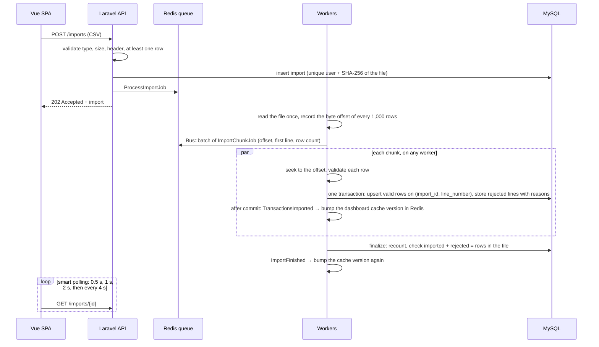

# Financial Import

[](https://github.com/filipelira1/financial-import/actions/workflows/ci.yml)

A CSV import and financial management system. A **Laravel 13 REST API** receives the CSV, a
**queue** validates it and stores it in parallel chunks, and a **Vue 3 SPA** shows the upload
progress, a cached income/expense/balance dashboard and a paginated list of transactions.

| Dashboard after importing the provided file | An import of 200,000 rows in progress |
|---|---|
|  |  |

- **Quick start:** `make up`, then open <http://localhost:8090> and sign in with `demo@example.com` / `password`.
- **Tests:** `make test` (backend), `make test-frontend` (frontend) and `make smoke` (end to end).
- **API docs:** <http://localhost:8090/docs/api>, or import [`docs/openapi.json`](docs/openapi.json) into Postman or Insomnia.

## Requirements → where → proof

| Requirement | Where | Proof |
|---|---|---|
| Isolated RESTful API, Laravel 9+ | Laravel 13, [`routes/api.php`](backend/routes/api.php) under `/api/v1` | [`docs/openapi.json`](docs/openapi.json); CI checks that it matches the code |
| API and SPA only for authenticated users | Sanctum Bearer tokens ([`AuthController`](backend/app/Http/Controllers/Api/V1/AuthController.php)); SPA route guard ([`router.ts`](frontend/src/router.ts)) | [`AuthenticationTest`](backend/tests/Feature/Auth/AuthenticationTest.php); `requires a token on every import endpoint` in [`ImportApiTest`](backend/tests/Feature/Imports/ImportApiTest.php) |
| CSV upload, reading, validation and storage in the background | [`StartImportAction`](backend/app/Application/Import/StartImportAction.php), [`ProcessImportJob`](backend/app/Jobs/ProcessImportJob.php), [`ImportChunkJob`](backend/app/Jobs/ImportChunkJob.php), [`TransactionRowParser`](backend/app/Domain/Import/TransactionRowParser.php), [`CsvReader`](backend/app/Infrastructure/Csv/CsvReader.php) | [`ImportProcessingTest`](backend/tests/Feature/Imports/ImportProcessingTest.php) (dirty files, idempotency), [`RealFileAcceptanceTest`](backend/tests/Feature/Imports/RealFileAcceptanceTest.php) (15,000 rows, exact totals), `make smoke` |
| Job dispatched on upload | `ProcessImportJob` on the `imports` queue, then a `Bus::batch` of chunks | `Queue::assertPushedOn` in `ImportApiTest`; `Bus::assertBatched` in `ImportProcessingTest` |
| Cached dashboard (income, expense, balance), invalidated by events/observers | [`GetDashboardSummaryAction`](backend/app/Application/Finance/GetDashboardSummaryAction.php), [`DashboardSummaryCache`](backend/app/Infrastructure/Cache/DashboardSummaryCache.php), [`InvalidateDashboardSummary`](backend/app/Listeners/InvalidateDashboardSummary.php), [`TransactionObserver`](backend/app/Observers/TransactionObserver.php) | [`DashboardSummaryTest`](backend/tests/Feature/Dashboard/DashboardSummaryTest.php), run on the real Redis store |
| An expense never counts as income | [`FinancialSummary`](backend/app/Domain/Finance/FinancialSummary.php) (the only balance rule), `CHECK` constraints in the [migration](backend/database/migrations/2026_11_24_100001_create_transactions_table.php) | [`FinancialSummaryTest`](backend/tests/Unit/Domain/FinancialSummaryTest.php), `never counts an expense as income` (dashboard and import), [`TransactionConstraintsTest`](backend/tests/Feature/Database/TransactionConstraintsTest.php) |
| Vue: paginated list and upload with visual feedback | [`TransactionsView`](frontend/src/views/TransactionsView.vue), [`ImportPanel`](frontend/src/components/ImportPanel.vue), [`usePolling`](frontend/src/composables/usePolling.ts) | Vitest ([`usePolling.test.ts`](frontend/src/composables/usePolling.test.ts), [`useImportTracker.test.ts`](frontend/src/composables/useImportTracker.test.ts)); screenshots above |
| Docker Compose: app, MySQL, Redis, worker | [`docker-compose.yml`](docker-compose.yml) (plus nginx and scheduler) | The CI `stack` job starts it from scratch and imports the real file |
| Tests with Pest or PHPUnit | Pest 5 (backend), Vitest (frontend) | `make test`, `make test-frontend`, [CI](.github/workflows/ci.yml) |
| Extra: DDD, SOLID, Actions/Services/Repositories, thin controllers | `app/Domain`, `app/Application`, `app/Infrastructure` ([Architecture](#architecture)) | [`ArchitectureTest`](backend/tests/Unit/ArchitectureTest.php) |
| Extra: API documentation | Scramble (generated from the code) | <http://localhost:8090/docs/api>, `docs/openapi.json` |
| Extra: CI running the tests | [GitHub Actions](.github/workflows/ci.yml): backend, frontend, full stack | Badge above |
| Extra: notice when processing ends | Smart polling (back-off, pauses with the tab hidden); `ImportFinished` event ready for WebSockets | `usePolling.test.ts` |
| Extra: everything in English | Code, commits, README, API docs | — |

---

## Contents

1. [Quick start](#quick-start)
2. [Running the tests](#running-the-tests)
3. [What runs where](#what-runs-where)
4. [API](#api)
5. [How an import works](#how-an-import-works)
6. [Import rules](#import-rules)
7. [Architecture](#architecture)
8. [Design patterns](#design-patterns)
9. [Design decisions](#design-decisions)
10. [Measured performance](#measured-performance)
11. [Limitations and next steps](#limitations-and-next-steps)
12. [Troubleshooting](#troubleshooting)

---

## Quick start

**Requirements:** Docker with Compose v2. `make` is optional. Ports **8090** and **127.0.0.1:33070** must be free.

```bash
git clone https://github.com/filipelira1/financial-import.git
cd financial-import
make up
```

Without `make`:

```bash
HOST_UID=$(id -u) HOST_GID=$(id -g) docker compose up -d --build --wait
```

The first start builds the images, installs the PHP dependencies, runs the migrations and creates
the demo user. That took **2 min 41 s** on a clean GitHub runner; later starts take seconds. Then:

1. Open <http://localhost:8090> and sign in with **`demo@example.com` / `password`**.
2. Drop [`backend/tests/fixtures/financial_transactions.csv`](backend/tests/fixtures/financial_transactions.csv)
   (the file provided with the assignment) on the upload area.
3. Watch the progress bar. The dashboard should end at **income R$ 36.119.609,74**,
   **expenses R$ 26.709.545,74** and **balance R$ 9.410.064,00** (15,000 transactions).

`make help` lists every shortcut. `make down` stops the stack. `make fresh` empties the database
(keeping the demo user).

## Running the tests

| Command | What it runs |
|---|---|
| `make test` | **Backend:** Pest on MySQL 8.4 (a separate `financial_import_test` schema), with the dashboard tests on the real Redis store (database 15): unit, feature, an acceptance test with the real 15,000-row file, and architecture tests. |
| `make test-frontend` | **Frontend:** type-check and Vitest, in a throwaway Node container (no Node.js needed on the host). With Node 22 installed: `cd frontend && npm ci && npm test`. |
| `make smoke` | **End to end, against the running stack:** signs in, imports the provided CSV through the API, waits for the queue and compares the dashboard with the expected totals. |
| `make lint` | Pint (code style). |

The same checks run in [GitHub Actions](.github/workflows/ci.yml) on every push:
- **backend:** Pint, Pest on MySQL and Redis services, and a check that `docs/openapi.json` matches the code;
- **frontend:** type-check, Vitest and the production build;
- **stack:** `docker compose up` exactly as above, followed by the smoke test.

## What runs where

| Service | Role |
|---|---|
| `nginx` | Serves the Vue SPA (built inside the image) and proxies `/api`, `/docs` and `/up` to PHP. Port **8090**. |
| `app` | PHP-FPM 8.4 with Laravel 13. On start it installs dependencies, migrates and seeds; its healthcheck pings PHP-FPM itself. |
| `worker` | `queue:work` on Redis (`imports` queue first). Scale it with `docker compose up -d --scale worker=3`. |
| `scheduler` | `schedule:work`: prunes expired tokens, recovers stuck imports, discards failed imports that were never retried. |
| `mysql` | MySQL 8.4 (data and test schema). Exposed only on `127.0.0.1:33070`. |
| `redis` | Redis 7.4: queue, cache, rate limits and locks. Not exposed. |

## API

All endpoints live under `/api/v1`, return JSON and, except login, need `Authorization: Bearer <token>`.
- **Interactive docs**, generated from the code by Scramble: **<http://localhost:8090/docs/api>**. The page
  is only served when `APP_ENV=local`, the default in `.env.example`.
- **The same OpenAPI document** is in [`docs/openapi.json`](docs/openapi.json), ready to import into Postman
  or Insomnia. `make docs` regenerates it.

| Method | Path | Description |
|---|---|---|
| `POST` | `/auth/login` | E-mail and password in exchange for a token (expires in 8 h). Throttled per account and per IP. |
| `POST` | `/auth/logout` | Revokes the current token. |
| `GET` | `/auth/me` | The authenticated user. |
| `POST` | `/imports` | Uploads a CSV (`multipart/form-data`, field `file`). Answers **202** at once with the import; **409** if the same file was already uploaded; **422** for a wrong file or header. |
| `GET` | `/imports` | The user's imports, newest first. |
| `GET` | `/imports/{id}` | Status and progress (`progress` 0–100, `is_finished`), for polling. |
| `GET` | `/imports/{id}/failures` | Rejected lines: line number, content and reasons. |
| `POST` | `/imports/{id}/retry` | Runs a failed import again (**409** if it did not fail). Rows already stored are not duplicated. |
| `GET` | `/dashboard/summary` | `income_cents`, `expense_cents`, `balance_cents`, `transaction_count` (cached). |
| `GET` | `/transactions` | Paginated list, newest first. Filters: `type`, `from`, `to` (`YYYY-MM-DD`), `per_page` (5–100), `page`. |

Another user's import answers **404**, exactly like one that does not exist. **Amounts are integer
cents** (`115346` = R$ 1.153,46).

```bash
TOKEN=$(curl -s -X POST localhost:8090/api/v1/auth/login -H 'Content-Type: application/json' \
  -d '{"email":"demo@example.com","password":"password"}' | jq -r .data.token)

curl -s -X POST localhost:8090/api/v1/imports -H "Authorization: Bearer $TOKEN" -H 'Accept: application/json' \
  -F file=@backend/tests/fixtures/financial_transactions.csv
curl -s localhost:8090/api/v1/dashboard/summary -H "Authorization: Bearer $TOKEN"
```

## How an import works



## Import rules

- **Header:** `date`, `description`, `amount` and `type`, in any order and any letter case. Extra columns are ignored.
- **File:** UTF-8 or Windows-1252 (Latin-1); comma, semicolon or tab separators; BOM and CRLF are fine; up to 20 MB.
- **`date`:** `YYYY-MM-DD` and a real calendar date (`2025-02-30` is rejected).
- **`description`:** required, at most 255 characters.
- **`amount`:** a **positive integer in cents**. No sign, separators or decimals: `-500`, `1.234,56` and `12.5`
  are rejected rather than guessed.
- **`type`:** `Receita` → income, `Despesa` → expense (also `income` / `expense`), in any letter case.
- **Blank lines** are skipped. Line numbers match the file, and the header is line 1.
- **Invalid rows** do not stop the import. Valid rows are stored, each rejected line is kept with every reason,
  and the import ends as `completed_with_errors`.
- **The same file** (same SHA-256) uploaded twice by the same user answers **409**.

Possible statuses: `pending` → `processing` → `completed` | `completed_with_errors` | `failed`.

## Architecture

```
backend/app
├── Domain/                 plain PHP, no framework (enforced by tests/Unit/ArchitectureTest.php)
│   ├── Finance/            TransactionType, TransactionData, FinancialSummary (the balance rule),
│   │                       TransactionRepository (port), TransactionsImported event
│   └── Import/             ImportStatus, TransactionRowParser (validation rules), RowRejection, ImportFinished
├── Application/            use cases (Actions): StartImport, PlanImport, ImportChunk, FinalizeImport,
│                           RetryImport, RecoverStuckImports, DiscardFailedImports, GetDashboardSummary,
│                           ListTransactions
├── Infrastructure/         CsvReader (streaming, byte offsets), DbTransactionRepository (bulk upsert, sums),
│                           DashboardSummaryCache (versioned keys)
├── Http/                   thin controllers, FormRequests, API Resources
├── Jobs/                   ProcessImportJob (plans and fans out), ImportChunkJob (one chunk)
├── Listeners/, Observers/  dashboard cache invalidation
└── Models/                 Eloquent models (persistence)

frontend/src
├── api/                    fetch client (Bearer, typed errors), endpoints
├── composables/            usePolling (smart polling), useImportTracker
├── stores/                 session (Pinia)
├── components/, views/     dashboard, import panel, transactions
└── types/api.ts            the API contract (mirrors the Laravel Resources)
```

Architecture tests (Pest `arch()`) enforce four rules:
- the domain uses nothing from Laravel, models, HTTP or infrastructure;
- domain events and data objects are `final readonly`;
- use cases do not know about HTTP;
- controllers run no queries and dispatch no jobs.

## Design patterns

| Pattern | Where | Why here |
|---|---|---|
| **Action / use case** | `app/Application/*Action.php` | One class per use case. Controllers, jobs and commands only translate input and call it, so the same use case serves HTTP, queue and CLI. |
| **Repository (port and adapter)** | Port: `Domain/Finance/Contracts/TransactionRepository`; adapter: `Infrastructure/Persistence/DbTransactionRepository` | Only where the query is the point: the bulk upsert and the aggregate. Plain reads use Eloquent directly, because a repository in front of every model would be ceremony. |
| **Domain event + listener** | `TransactionsImported`, `ImportFinished` → `InvalidateDashboardSummary` | Bulk upserts bypass Eloquent, so a model observer cannot see imported rows. The import announces them. |
| **Observer** | `TransactionObserver` | Covers transactions written one at a time through Eloquent (a seeder, tinker, a future manual-entry endpoint). Tested by `is refreshed when a single transaction is saved or deleted` in [`DashboardSummaryTest.php:131`](backend/tests/Feature/Dashboard/DashboardSummaryTest.php#L131). |
| **DTO / value object** | `TransactionData` (a validated row), `FinancialSummary` (totals and the balance rule), `CsvChunk` (a job's payload) | Immutable (`final readonly`), so validity is checked once in the constructor. |
| **Enum** | `TransactionType`, `ImportStatus` | Closed sets of values, cast on the models and backed by `CHECK` constraints. |
| **Batch / fan-out** | `ProcessImportJob` → `Bus::batch(ImportChunkJob…)` → `finally` | Parallel chunks with progress and a single finalize step. |

On top of the patterns:
- **Events after the commit, by convention:** events are dispatched with `DB::afterCommit()` at the dispatch
  site, not with `ShouldDispatchAfterCommit` on the event, because domain events must stay plain PHP (the
  architecture test forbids Laravel in the domain). The guarantee is the same: listeners only ever see
  committed rows, even if a caller wraps the use case in its own transaction.
- **Strict models in development:** `Model::shouldBeStrict()` makes N+1 queries and silently dropped
  attributes fail loudly outside production.

## Design decisions

**1. Money is an integer number of cents.**
- **Decision:** a `BIGINT` that is always positive. The sign comes from `type`, and the balance rule
  (`income − expense`) lives in one place, `FinancialSummary`.
- **Why:** floats lose cents. The provided file only has integers from 5001 to 1499842, so cents is the only
  unambiguous reading.
- **Database guard:** `CHECK (type IN ('income','expense'))` and `CHECK (amount_cents > 0)`.

**2. The queue carries an address, not the data.**
- **Decision:** `ProcessImportJob` reads the file once and records the byte offset where every chunk of
  1,000 rows starts. Each `ImportChunkJob` seeks straight there.
- **Why:** Redis holds three integers per job, and worker memory is the same for 15 thousand or 15 million
  rows. Chunks run in a `Bus::batch` (progress, `allowFailures`, `finally`), so more workers means more
  parallel chunks.

**3. Idempotency at two levels.**
- **File:** a unique index on `(user_id, file_hash)`. Two identical uploads racing each other are settled by
  the database, and the loser gets a 409.
- **Row:** a unique index on `(import_id, line_number)` plus an upsert. Queues deliver at least once, so a
  chunk that runs twice (for example, a worker died after the commit) inserts nothing new, and the counters
  grow only by the rows really stored.
- **Why not `INSERT IGNORE`:** in MySQL it would also turn real errors (truncation, `CHECK`, foreign keys)
  into warnings.
- **Caveat:** in MySQL, the no-op upsert counts 0 affected rows and fires on any unique key, which is safe
  here because that is the table's only one. In PostgreSQL, `ON CONFLICT DO NOTHING` would be the
  equivalent.

**4. Partial import with a report, plus a counting barrier.**
- **Decision:** a bad line becomes a reported rejection, not a failed file. When the batch ends, the import
  is recounted from the tables, and it only completes if `imported + rejected = rows in the file`.
  Otherwise it fails with the reason and can be retried without duplicates.
- **Why:** rejecting 14,999 good rows because of one bad line wastes the user's work.

**5. Dashboard cache with a versioned key.**
- **Decision:** the key is `dashboard:summary:{user}:v{version}`, and invalidating means incrementing the
  version.
- **Why not delete the key:** a read that started before an import committed could write the old totals
  back right after the delete. With a version, that late write lands on a key nobody reads.
- **What invalidates it:** the domain events and the observer described above. One-hour TTL as a safety net.
- **What it computes:** one aggregate query on a covering index. The cache stores a plain array, because
  Laravel 13 refuses to unserialize objects from the cache. The dashboard tests run on the real Redis store:
  the in-memory array store would hide that trap (verified: caching the object fails there with
  `__PHP_Incomplete_Class`).

**6. Counters outside the chunk transaction (a deadlock found by measuring).**
- **The problem:** with three workers, imports failed: 3 of 15 chunks exhausted their retries on deadlocks.
  Inserting a transaction takes a shared lock on the parent import row (foreign key check), and updating
  that row's counters in the same transaction needs an exclusive one. Two chunks committing together wait
  for each other.
- **The fix:** the counters only feed the progress bar, so they are updated after the commit, and the
  finalize step recounts from the tables. The chunk transaction also retries itself on a deadlock.
- **Result:** 0 deadlocks (InnoDB metrics) and 0 failed jobs with three workers.

**7. Token authentication for a truly separate SPA.**
- **Tokens:** Sanctum Bearer tokens (8 h), with session fallback disabled. The SPA is served from the same
  origin as the API, so there is no CORS.
- **Login:** the password check runs in Laravel's timebox, so an unknown e-mail and a wrong password take the
  same time and get the same message. Attempts are throttled per account and per IP.
- **Token storage in the browser:** the token lives in `sessionStorage` (per tab, gone when the browser
  closes).
- **CSP:** the SPA is served with a strict Content-Security-Policy (`script-src 'self'`, `connect-src 'self'`),
  which reduces the impact of an XSS.

**8. Smart polling instead of WebSockets.**
- **Decision:** the import finishes once, so the SPA polls with back-off (0.5 s, 1 s, 2 s, then every 4 s).
  It stops by itself, pauses while the tab is hidden, and after repeated failures it says the connection was
  lost and offers to resume.
- **Trade-off:** no WebSocket server to run. Laravel Reverb is the natural next step, and `ImportFinished`
  is already in place.

**9. Tests run on MySQL (and Redis), not SQLite.**
- **Why:** aggregates, upserts, `CHECK` constraints and locks behave differently across engines, and so do
  cache stores.
- **How:** tests use a separate schema on the same MySQL 8.4 and Redis database 15, and CI uses MySQL and
  Redis services. One acceptance test imports the real 15,000-row file and checks the expected totals.

**10. Deep pages read from the index (deferred join).**
- **Order:** the list is ordered by `(occurred_on DESC, id DESC)`. The `id` tie-breaker keeps pages from
  shuffling.
- **Deferred join:** with plain `OFFSET`, MySQL fetched and discarded every row before the page (page 751:
  68 ms). Now the page's ids come from the covering index `(user_id, occurred_on, id)` (or
  `(user_id, type, occurred_on, id)` when filtering by type), and only those rows are read: 4 ms.
- **What is left:** each page still costs one `COUNT(*)` over the user's rows, which "page N of M" needs.
  At millions of rows, cursor pagination (no total, no jump to page N) would be the move.

**11. Operations.**
- **Scheduler:** expired tokens are pruned. An import with no progress for an hour is failed so it can be
  retried (every chunk touches `updated_at`). A failed import not retried within 7 days is discarded with its
  file and partial rows, and can then be uploaded again.
- **Stored files:** an uploaded file is deleted once its rows are stored.

**12. One command to start.**
- **Decision:** the `app` container installs dependencies, migrates and seeds on start, and the worker,
  scheduler and nginx wait for its healthcheck.
- **Production:** migrations would be a release step instead of a boot step.

## Measured performance

Laptop, Docker on WSL2. Each row says how to reproduce it.

| What | Result | How |
|---|---|---|
| First `make up` on a clean machine | 2 min 41 s | CI job "Full stack" (GitHub runner, no cache) |
| Upload answered (202) | 0.08 – 0.24 s | `curl -w '%{time_total}'` on `POST /api/v1/imports` |
| Provided file (15,000 rows), 1 worker | 1.6 – 3.0 s, ~90 ms per 1,000-row chunk | `make fresh && make smoke` (prints the time); `make logs` shows `import.chunk … "ms"` |
| Provided file, 3 workers | 1.1 – 2.7 s, 0 deadlocks, 0 failed jobs | `docker compose up -d --scale worker=3 --no-recreate`, then the same |
| 200,000 rows, 1 worker vs 3 workers | 47 s vs 33 s | Same, with a larger generated file |
| Dashboard summary | 54 ms on a cold cache, 21 ms cached | `curl -w '%{time_total}'` twice on `GET /api/v1/dashboard/summary` |
| Dashboard query | Covering index lookup: the 15,004 rows are read from the index only, 8 ms in total | `EXPLAIN ANALYZE` below |
| Transaction list, page 751 (offset 15,000) | 68 ms → **4 ms** with the deferred join; endpoint 25 ms | `EXPLAIN ANALYZE` below |

```sql
-- Dashboard: "Covering index lookup on transactions using transactions_user_id_type_amount_cents_index"
EXPLAIN ANALYZE SELECT SUM(CASE WHEN type = 'income' THEN amount_cents ELSE 0 END),
                       SUM(CASE WHEN type = 'expense' THEN amount_cents ELSE 0 END), COUNT(*)
FROM transactions WHERE user_id = 1;

-- Page 751: the ids come from "Covering index lookup ... (reverse)", then 20 primary-key lookups
EXPLAIN ANALYZE SELECT transactions.* FROM transactions
INNER JOIN (SELECT id FROM transactions WHERE user_id = 1
            ORDER BY occurred_on DESC, id DESC LIMIT 20 OFFSET 15000) AS page ON page.id = transactions.id
ORDER BY transactions.occurred_on DESC, transactions.id DESC;
```

Run them with `docker compose exec mysql mysql -uapp -psecret financial_import`.

**Reading the numbers:**
- **Idle workers wake at once:** they wait on Redis with a blocking pop (`block_for`), so a new chunk starts
  right away instead of after the default 3-second poll.
- **Small files:** with 15,000 rows the time is mostly fixed cost (queue pickup, planning, finalize), so extra
  workers barely change it.
- **Large files:** at 200,000 rows, three workers cut 47 s to 33 s. What limits the rest is MySQL's write
  throughput on this machine, not PHP.

## Limitations and next steps

- **Duplicate rows:** the CSV has no transaction identifier, so two *different* files with overlapping rows
  both get imported. A fingerprint warning with user confirmation would be the next step.
- **Shared storage:** workers share a local volume with the uploaded file. Across several hosts, this would
  be S3 (or any object storage) with ranged reads per chunk.
- **Real-time updates:** polling today. Reverb would broadcast `ImportFinished`.
- **Pagination at scale:** cursor pagination instead of `COUNT(*)` with page numbers.
- **Queue operations:** a single Redis instance. Horizon would add per-queue metrics and balancing.

## Troubleshooting

- **Port already in use:** `APP_PORT=8091 MYSQL_PORT=33071 make up`.
- **Files owned by another user on Linux:** `make up` passes your user ID to the images. With plain
  Compose, use `HOST_UID=$(id -u) HOST_GID=$(id -g) docker compose up -d --build --wait`.
- **Worker code changes:** `make restart-worker` (queue workers keep the code in memory).
- **Start over with an empty database:** `make fresh`.
- **Logs:** `make logs`. Each chunk logs `import.chunk` with its row counts and duration.
