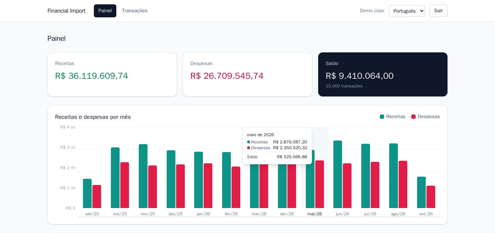
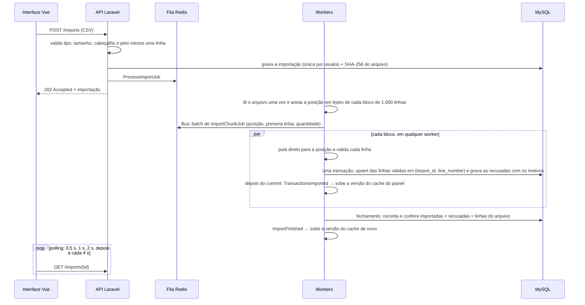

# Financial Import

[English version](README.en.md) · **Português**

[](https://github.com/filipelira1/financial-import/actions/workflows/ci.yml)

Importação e acompanhamento de transações financeiras a partir de arquivos CSV. O usuário envia um ou
mais arquivos, a importação roda em segundo plano com progresso na tela, e o painel mostra receitas,
despesas, saldo e a evolução mês a mês. As linhas com problema não travam o arquivo: ficam guardadas
com o motivo, para corrigir e reenviar.

| Painel com os totais e o gráfico mensal | Importação de 200 mil linhas em andamento |
|---|---|
|  |  |

## Funcionalidades

- **Importação em segundo plano:** o envio responde na hora e a fila processa o arquivo em blocos
  paralelos. A barra de progresso acompanha cada bloco.
- **Vários arquivos de uma vez:** até 10 por envio, cada um vira uma importação, com o resultado
  mostrado arquivo por arquivo. O mesmo arquivo enviado duas vezes é recusado, com link para a
  importação anterior.
- **Linhas recusadas com o motivo:** listadas na tela e disponíveis em CSV, com o número da linha, os
  motivos e o conteúdo original.
- **Painel:** receitas, despesas e saldo, mais um gráfico de receitas e despesas por mês. Tudo vem do
  cache e é renovado quando entram transações novas.
- **Transações:** lista paginada com filtro por tipo, por período e busca pela descrição. A busca não
  diferencia maiúsculas nem acentos.
- **Exportação:** a lista filtrada sai em CSV no mesmo formato da importação, então o arquivo exportado
  pode ser importado de novo.
- **Português e inglês:** a interface e as mensagens da API seguem o idioma escolhido no topo da tela.
- **Acesso autenticado:** a API e a interface só respondem a usuários com token válido.

## Stack

| Camada | Tecnologia |
|---|---|
| API | PHP 8.4, Laravel 13, Sanctum (token Bearer), Scramble (documentação OpenAPI gerada do código) |
| Fila e cache | Redis 7.4, `Bus::batch` do Laravel |
| Banco | MySQL 8.4 |
| Interface | Vue 3, TypeScript, Vite, Pinia, Vue Router, Tailwind CSS 4 |
| Testes | Pest (backend, no MySQL e no Redis de verdade), Vitest (frontend), teste ponta a ponta em shell |
| Ambiente | Docker Compose: nginx, PHP-FPM, worker da fila, agendador, MySQL e Redis |
| CI | GitHub Actions: backend, frontend e a pilha completa subindo do zero |

Código, commits e documentação da API em inglês. A interface e as mensagens da API em português ou inglês.

---

## Sumário

1. [Como executar](#como-executar)
2. [Testes](#testes)
3. [Arquitetura](#arquitetura)
4. [Formato do CSV](#formato-do-csv)
5. [API](#api)
6. [Decisões técnicas](#decisões-técnicas)
7. [Desempenho medido](#desempenho-medido)
8. [Limites e próximos passos](#limites-e-próximos-passos)
9. [Problemas comuns](#problemas-comuns)

---

## Como executar

**Pré-requisitos:** Docker com Compose v2. O `make` é opcional. As portas **8090** e **127.0.0.1:33070**
precisam estar livres.

```bash
git clone https://github.com/filipelira1/financial-import.git
cd financial-import
make up
```

Sem `make`:

```bash
HOST_UID=$(id -u) HOST_GID=$(id -g) docker compose up -d --build --wait
```

A primeira subida gera as imagens, instala as dependências, roda as migrations e cria o usuário de
demonstração. Numa máquina limpa leva cerca de 3 minutos; as próximas levam segundos. Depois:

1. Abra <http://localhost:8090> e entre com **`demo@example.com` / `password`**.
2. Arraste o arquivo de exemplo [`backend/tests/fixtures/financial_transactions.csv`](backend/tests/fixtures/financial_transactions.csv)
   (15 mil transações) para a área de envio.
3. Acompanhe a barra de progresso. O painel termina em **receitas R$ 36.119.609,74**,
   **despesas R$ 26.709.545,74** e **saldo R$ 9.410.064,00**.

| Comando | O que faz |
|---|---|
| `make help` | Lista todos os atalhos. |
| `make down` | Para a pilha. |
| `make fresh` | Esvazia o banco, mantendo o usuário de demonstração. |
| `make logs` | Acompanha os logs da API e do worker. |
| `make docs` | Gera de novo o `docs/openapi.json`. |

## Testes

| Comando | O que roda |
|---|---|
| `make test` | **Backend:** Pest no MySQL 8.4 (schema separado `financial_import_test`) e no Redis (banco 15). Unidade, feature, arquitetura e um teste de aceitação que importa o arquivo de exemplo e confere os totais. |
| `make test-frontend` | **Frontend:** type-check e Vitest, num container Node descartável (não precisa de Node.js na máquina). Com Node 22 instalado: `cd frontend && npm ci && npm test`. |
| `make smoke` | **Ponta a ponta, contra a pilha no ar:** entra, importa o arquivo de exemplo pela API, espera a fila e compara o painel com os totais esperados. |
| `make lint` | Pint (estilo do código). |

O [GitHub Actions](.github/workflows/ci.yml) roda a cada push:
- **backend:** Pint, Pest com MySQL e Redis de serviço, e a conferência de que o `docs/openapi.json` bate com o código;
- **frontend:** type-check, Vitest e o build de produção;
- **stack:** `docker compose up` do zero, seguido do teste ponta a ponta.

## Arquitetura

### Serviços

| Serviço | Papel |
|---|---|
| `nginx` | Entrega a interface (gerada dentro da imagem) e repassa `/api`, `/docs` e `/up` ao PHP. Porta **8090**. |
| `app` | PHP-FPM 8.4 com Laravel 13. Ao subir, instala dependências, roda migrations e seed. |
| `worker` | `queue:work` no Redis, com a fila `imports` primeiro. Escala com `docker compose up -d --scale worker=3`. |
| `scheduler` | `schedule:work`: apaga tokens vencidos, recupera importações travadas e descarta importações com falha que nunca foram repetidas. |
| `mysql` | Dados da aplicação e schema de teste. Exposto só em `127.0.0.1:33070`. |
| `redis` | Fila, cache, limites de tentativa e travas. Não exposto. |

### Como uma importação funciona



### Camadas do código

```
backend/app
├── Domain/                 PHP puro, sem framework
│   ├── Finance/            TransactionType, TransactionData, FinancialSummary (a regra de saldo),
│   │                       TransactionRepository (porta), evento TransactionsImported
│   └── Import/             ImportStatus, TransactionRowParser (validação da linha), RowRejection,
│                           evento ImportFinished
├── Application/            casos de uso (Actions)
│   ├── Import/             StartImport, PlanImport, ImportChunk, FinalizeImport, RetryImport,
│   │                       RecoverStuckImports, DiscardFailedImports
│   └── Finance/            GetDashboardSummary, GetMonthlySummary, ListTransactions,
│                           ExportTransactions, TransactionFilters
├── Infrastructure/         CsvReader (leitura em streaming, posições em bytes), DbTransactionRepository
│                           (upsert em lote, somas), DashboardSummaryCache (chaves com versão)
├── Http/                   controllers finos, FormRequests, API Resources, CsvDownload,
│                           ReasonTranslator, middleware de idioma
├── Jobs/                   ProcessImportJob (planeja e distribui), ImportChunkJob (um bloco)
├── Listeners/, Observers/  invalidação do cache do painel
└── Models/                 models Eloquent (persistência)

frontend/src
├── api/                    cliente fetch (Bearer, erros tipados, downloads), rotas da API
├── composables/            usePolling (intervalo crescente), useImportTracker
├── stores/                 sessão (Pinia)
├── components/, views/     painel, gráfico mensal, área de envio, transações
├── i18n/                   dicionário tipado em português e inglês
└── types/api.ts            o contrato da API (espelha os Resources do Laravel)
```

Testes de arquitetura (Pest `arch()`, em [`ArchitectureTest`](backend/tests/Unit/ArchitectureTest.php))
mantêm quatro regras:
- o domínio não usa nada do Laravel, dos models, do HTTP nem da infraestrutura;
- eventos e objetos de dados do domínio são `final readonly`;
- os casos de uso não conhecem HTTP;
- os controllers não fazem consulta nem despacham job.

### Padrões de projeto

| Padrão | Onde | Por que aqui |
|---|---|---|
| **Action / caso de uso** | `app/Application/*Action.php` | Uma classe por caso de uso. Controllers, jobs e comandos só traduzem a entrada e chamam a Action, então o mesmo caso de uso serve HTTP, fila e linha de comando. |
| **Repository (porta e adaptador)** | Porta: `Domain/Finance/Contracts/TransactionRepository`; adaptador: `Infrastructure/Persistence/DbTransactionRepository` | Só onde a consulta é o ponto central: o upsert em lote e as somas. Leituras simples usam o Eloquent direto. |
| **Evento de domínio + listener** | `TransactionsImported`, `ImportFinished` → `InvalidateDashboardSummary` | O upsert em lote passa por fora do Eloquent, então um observer do model não vê as linhas importadas. A importação avisa. |
| **Observer** | `TransactionObserver` | Cobre transações gravadas uma a uma pelo Eloquent (seeder, tinker, um futuro lançamento manual). |
| **DTO / Value Object** | `TransactionData`, `FinancialSummary`, `CsvChunk`, `TransactionFilters` | Imutáveis (`final readonly`): a validade é conferida uma vez, no construtor. |
| **Enum** | `TransactionType`, `ImportStatus` | Conjuntos fechados de valores, convertidos nos models e garantidos por restrições `CHECK`. |
| **Batch / fan-out** | `ProcessImportJob` → `Bus::batch(ImportChunkJob…)` → `finally` | Blocos em paralelo, com progresso e um único passo de fechamento. |

## Formato do CSV

- **Cabeçalho:** `date`, `description`, `amount` e `type`, em qualquer ordem, com maiúsculas ou minúsculas. Colunas a mais são ignoradas.
- **Arquivo:** UTF-8 ou Windows-1252; separador vírgula, ponto e vírgula ou tab; BOM e CRLF aceitos; até 20 MB.
- **`date`:** `YYYY-MM-DD`, uma data que existe no calendário (`2025-02-30` é recusada).
- **`description`:** obrigatória, até 255 caracteres.
- **`amount`:** **inteiro positivo em centavos**. `-500`, `1.234,56` e `12.5` são recusados, em vez de adivinhados.
- **`type`:** `Receita` ou `Despesa` (também `income` / `expense`), com maiúsculas ou minúsculas.
- **Linhas em branco** são puladas. O número da linha é o do arquivo, com o cabeçalho na linha 1.
- **Linhas inválidas** não param a importação: as válidas são gravadas, cada recusada fica guardada com
  todos os motivos, e a importação termina como `completed_with_errors`.
- **O mesmo arquivo** (mesmo SHA-256) enviado de novo pelo mesmo usuário responde **409**.

Situações de uma importação: `pending` → `processing` → `completed` | `completed_with_errors` | `failed`.

## API

Todas as rotas ficam em `/api/v1`, respondem JSON e, exceto o login, exigem `Authorization: Bearer <token>`.
- **Documentação interativa**, gerada do código: **<http://localhost:8090/docs/api>** (com `APP_ENV=local`,
  o padrão do `.env.example`).
- **O documento OpenAPI** está em [`docs/openapi.json`](docs/openapi.json), pronto para o Postman ou o Insomnia.
  A CI confere que ele bate com o código.

| Método | Caminho | Descrição |
|---|---|---|
| `POST` | `/auth/login` | E-mail e senha em troca de um token (vence em 8 h). Limite de tentativas por conta e por IP. |
| `POST` | `/auth/logout` | Revoga o token atual. |
| `GET` | `/auth/me` | O usuário autenticado. |
| `POST` | `/imports` | Envia um CSV (`multipart/form-data`, campo `file`). **202** na hora com a importação; **409** se o arquivo já foi enviado; **422** para arquivo ou cabeçalho errado. |
| `GET` | `/imports` | As importações do usuário, da mais nova para a mais antiga. |
| `GET` | `/imports/{id}` | Situação e progresso (`progress` de 0 a 100, `is_finished`). |
| `GET` | `/imports/{id}/failures` | Linhas recusadas: número da linha, conteúdo e motivos no idioma pedido. |
| `GET` | `/imports/{id}/failures/export` | As mesmas linhas recusadas em CSV. |
| `POST` | `/imports/{id}/retry` | Roda de novo uma importação que falhou (**409** se ela não falhou). Linhas já gravadas não duplicam. |
| `GET` | `/dashboard/summary` | `income_cents`, `expense_cents`, `balance_cents`, `transaction_count` (em cache). |
| `GET` | `/dashboard/monthly` | Os mesmos totais por mês (`YYYY-MM`), do mais antigo para o mais novo (em cache). |
| `GET` | `/transactions` | Lista paginada, da mais nova para a mais antiga. Filtros: `type`, `from`, `to` (`YYYY-MM-DD`), `q` (parte da descrição), `per_page` (5 a 100), `page`. |
| `GET` | `/transactions/export` | As transações dos mesmos filtros em CSV, no formato da importação. |

A importação de outro usuário responde **404**, igual a uma que não existe. **Valores são centavos
inteiros** (`115346` = R$ 1.153,46).

```bash
TOKEN=$(curl -s -X POST localhost:8090/api/v1/auth/login -H 'Content-Type: application/json' \
  -d '{"email":"demo@example.com","password":"password"}' | jq -r .data.token)

curl -s -X POST localhost:8090/api/v1/imports -H "Authorization: Bearer $TOKEN" -H 'Accept: application/json' \
  -F file=@backend/tests/fixtures/financial_transactions.csv
curl -s localhost:8090/api/v1/dashboard/summary -H "Authorization: Bearer $TOKEN"
```

## Decisões técnicas

**1. Dinheiro é um número inteiro de centavos.**
- **Decisão:** um `BIGINT` sempre positivo. O sinal vem do `type`, e a regra de saldo (`receitas − despesas`)
  fica num lugar só, o [`FinancialSummary`](backend/app/Domain/Finance/FinancialSummary.php).
- **Por quê:** float perde centavos, e um valor com sinal abre espaço para uma despesa somar como receita.
- **Proteção no banco:** `CHECK (type IN ('income','expense'))` e `CHECK (amount_cents > 0)`.

**2. A fila leva um endereço, não os dados.**
- **Decisão:** o `ProcessImportJob` lê o arquivo uma vez e anota a posição em bytes onde começa cada bloco de
  1.000 linhas. Cada `ImportChunkJob` pula direto para lá.
- **Por quê:** o Redis guarda três números por job, e a memória do worker é a mesma para 15 mil ou 15 milhões
  de linhas. Mais workers significam mais blocos em paralelo.

**3. Idempotência em dois níveis.**
- **Arquivo:** índice único em `(user_id, file_hash)`. Dois envios iguais ao mesmo tempo são resolvidos pelo
  banco, e o segundo recebe 409.
- **Linha:** índice único em `(import_id, line_number)` mais upsert. A fila entrega pelo menos uma vez, então
  um bloco que roda duas vezes não grava nada novo, e os contadores só crescem com linhas gravadas de verdade.
- **Por que não `INSERT IGNORE`:** no MySQL ele também transformaria erros reais (truncamento, `CHECK`, chave
  estrangeira) em simples avisos.

**4. Importação parcial com relatório, mais uma conferência de contagem.**
- **Decisão:** uma linha ruim vira uma recusa relatada, não um arquivo inteiro com falha. No fim, a importação
  é recontada a partir das tabelas e só conclui se `importadas + recusadas = linhas do arquivo`. Se não bater,
  ela falha com o motivo e pode ser repetida sem duplicar.
- **Por quê:** recusar 14.999 linhas boas por causa de uma ruim desperdiça o trabalho do usuário.

**5. Cache do painel com versão na chave.**
- **Decisão:** a chave é `dashboard:summary:{user}:v{version}`, e invalidar é subir a versão. O gráfico mensal
  usa a mesma versão, então os dois se renovam juntos.
- **Por que não apagar a chave:** uma leitura que começou antes do commit de uma importação poderia gravar os
  totais antigos logo depois do apagamento. Com a versão, essa gravação atrasada cai numa chave que ninguém lê.
- **O que invalida:** os eventos de domínio e o observer. TTL de uma hora como rede de segurança.
- **O que calcula:** uma soma sobre um índice que cobre a consulta. O cache guarda um array simples, porque o
  Laravel 13 recusa desserializar objetos do cache; os testes rodam no Redis de verdade para pegar isso.

**6. Contadores fora da transação do bloco (um deadlock achado medindo).**
- **O problema:** com três workers, 3 de 15 blocos esgotaram as tentativas por deadlock. Inserir uma transação
  pega uma trava compartilhada na linha da importação (chave estrangeira), e atualizar os contadores dessa
  linha na mesma transação pede uma trava exclusiva.
- **A correção:** os contadores só alimentam a barra de progresso, então são atualizados depois do commit, e o
  fechamento reconta a partir das tabelas. A transação do bloco também se repete sozinha em caso de deadlock.
- **Resultado:** 0 deadlocks (métricas do InnoDB) e 0 jobs com falha com três workers.

**7. Eventos depois do commit, com o domínio em PHP puro.**
- Os eventos são disparados com `DB::afterCommit()` no ponto de disparo, e não com `ShouldDispatchAfterCommit`
  no evento, para o domínio continuar sem Laravel. Os listeners só veem linhas já gravadas, mesmo que quem
  chama envolva o caso de uso numa transação própria.

**8. Autenticação por token para uma interface separada.**
- **Tokens:** Bearer do Sanctum (8 h), sem cair para sessão. A interface é servida no mesmo endereço da API,
  então não há CORS.
- **Login:** a conferência da senha roda num tempo fixo, então e-mail inexistente e senha errada levam o mesmo
  tempo e recebem a mesma mensagem. Tentativas limitadas por conta e por IP.
- **No navegador:** o token fica no `sessionStorage` (por aba), e a página sai com uma Content-Security-Policy
  estrita (`script-src 'self'`, `connect-src 'self'`).

**9. Polling com intervalo crescente em vez de WebSockets.**
- **Decisão:** uma importação termina uma vez só, então a interface consulta em 0,5 s, 1 s, 2 s e depois a cada
  4 s. O polling para sozinho, pausa com a aba escondida e, depois de falhas seguidas, avisa que a conexão
  caiu e oferece retomar.
- **Troca:** nenhum servidor de WebSocket para manter. O evento `ImportFinished` já existe para quando valer
  a pena usar o Laravel Reverb.

**10. Testes no MySQL e no Redis, não no SQLite.**
- Somas, upserts, restrições `CHECK` e travas se comportam diferente entre bancos, e o mesmo vale para os
  stores de cache. Os testes usam um schema separado no mesmo MySQL e o banco 15 do Redis.

**11. Páginas profundas lidas do índice (deferred join).**
- **Ordem:** `(occurred_on DESC, id DESC)`; o desempate pelo `id` impede que as páginas se embaralhem.
- **Deferred join:** com `OFFSET` simples, o MySQL lia e descartava todas as linhas antes da página (página
  751: 68 ms). Agora os ids da página saem do índice `(user_id, occurred_on, id)`, e só essas linhas são
  lidas: 4 ms.

**12. Exportação em fluxo, com memória constante.**
- **Decisão:** o CSV é escrito direto na resposta, lendo de mil em mil linhas por paginação por chave
  (`occurred_on`, `id`), nunca por `OFFSET`.
- **Formato:** o mesmo da importação, então o arquivo exportado volta pela importação sem nenhuma recusa.
  UTF-8 com BOM e `;` em português (o Excel brasileiro abre direto), `,` em inglês. Células que começam com
  `=`, `+`, `-` ou `@` ganham um `'` na frente, para a planilha não executar fórmula (CSV injection).

**13. Busca simples, sem motor de busca.**
- **Decisão:** `LIKE '%termo%'` na descrição, com `%` e `_` digitados tratados como texto. A collation do
  banco já ignora maiúsculas e acentos ("licenca" acha "Licença").
- **Troca:** o índice não serve a um curinga no começo, então a busca percorre as transações do usuário.
  Suficiente na escala de hoje; ver [Limites](#limites-e-próximos-passos).

**14. Idiomas: o que é gravado fica em inglês, o que é mostrado é traduzido.**
- **Interface:** dicionário tipado em [`frontend/src/i18n`](frontend/src/i18n); uma chave que falta ou um
  parâmetro errado quebra o type-check, sem biblioteca nova.
- **API:** a interface manda `Accept-Language`, e o middleware `SetLocaleFromHeader` responde validação, 404 e
  409 no mesmo idioma (sem o cabeçalho, inglês).
- **Motivos de recusa:** a fila grava em inglês, para o banco e os logs não dependerem de quem enviou. A API
  traduz na resposta ([`ReasonTranslator`](backend/app/Http/Localization/ReasonTranslator.php)), na tela e no
  CSV baixado.

**15. Um comando para subir.**
- O container `app` instala as dependências, roda as migrations e o seed ao subir, e o worker, o scheduler e
  o nginx esperam o healthcheck dele. Em produção, as migrations seriam um passo da publicação.

## Desempenho medido

Notebook, Docker no WSL2. Cada linha diz como reproduzir.

| O quê | Resultado | Como |
|---|---|---|
| Primeiro `make up` numa máquina limpa | 2 min 41 s | Job "Full stack" da CI (máquina do GitHub, sem cache) |
| Resposta do envio (202) | 0,08 a 0,24 s | `curl -w '%{time_total}'` no `POST /api/v1/imports` |
| Arquivo de exemplo (15 mil linhas), 1 worker | 1,6 a 3,0 s, ~90 ms por bloco de 1.000 linhas | `make fresh && make smoke`; `make logs` mostra `import.chunk … "ms"` |
| Arquivo de exemplo, 3 workers | 1,1 a 2,7 s, 0 deadlocks, 0 jobs com falha | `docker compose up -d --scale worker=3 --no-recreate`, depois o mesmo |
| 200 mil linhas, 1 worker × 3 workers | 47 s × 33 s | O mesmo, com um arquivo maior gerado |
| Resumo do painel | 54 ms com o cache frio, 21 ms do cache | `curl -w '%{time_total}'` duas vezes no `GET /api/v1/dashboard/summary` |
| Consulta do painel | Leitura só do índice, 8 ms para 15 mil linhas | `EXPLAIN ANALYZE` abaixo |
| Lista de transações, página 751 | 68 ms → **4 ms** com o deferred join | `EXPLAIN ANALYZE` abaixo |

```sql
-- Painel: "Covering index lookup on transactions using transactions_user_id_type_amount_cents_index"
EXPLAIN ANALYZE SELECT SUM(CASE WHEN type = 'income' THEN amount_cents ELSE 0 END),
                       SUM(CASE WHEN type = 'expense' THEN amount_cents ELSE 0 END), COUNT(*)
FROM transactions WHERE user_id = 1;

-- Página 751: os ids vêm de "Covering index lookup ... (reverse)", depois 20 buscas pela chave primária
EXPLAIN ANALYZE SELECT transactions.* FROM transactions
INNER JOIN (SELECT id FROM transactions WHERE user_id = 1
            ORDER BY occurred_on DESC, id DESC LIMIT 20 OFFSET 15000) AS page ON page.id = transactions.id
ORDER BY transactions.occurred_on DESC, transactions.id DESC;
```

Rode com `docker compose exec mysql mysql -uapp -psecret financial_import`.

- **Arquivos pequenos:** com 15 mil linhas, o tempo é quase todo custo fixo (pegar o job, planejar, fechar),
  então mais workers quase não mudam o resultado.
- **Arquivos grandes:** com 200 mil linhas, três workers baixam de 47 s para 33 s. O limite que sobra é a
  escrita do MySQL nesta máquina, não o PHP.

## Limites e próximos passos

- **Linhas repetidas entre arquivos:** o CSV não tem identificador da transação, então dois arquivos
  *diferentes* com linhas em comum são importados os dois. O próximo passo seria um aviso por impressão digital
  da linha, com confirmação do usuário.
- **Armazenamento compartilhado:** os workers dividem um volume local. Com várias máquinas, seria S3 (ou outro
  armazenamento de objetos) com leitura por faixa de bytes em cada bloco.
- **Tempo real:** hoje é polling. O Reverb transmitiria o `ImportFinished`.
- **Busca em escala:** com milhões de linhas por usuário, um índice `FULLTEXT`.
- **Paginação em escala:** cada página ainda conta o total para o "página N de M". Com milhões de linhas,
  paginação por cursor.
- **Fila:** uma única instância do Redis. O Horizon traria métricas e balanceamento por fila.

## Problemas comuns

- **Porta em uso:** `APP_PORT=8091 MYSQL_PORT=33071 make up`.
- **Arquivos com outro dono no Linux:** o `make up` passa o seu ID de usuário para as imagens. Com Compose
  puro, use `HOST_UID=$(id -u) HOST_GID=$(id -g) docker compose up -d --build --wait`.
- **Mudança no código do worker:** `make restart-worker` (os workers guardam o código na memória).
- **Começar de novo com o banco vazio:** `make fresh`.
- **Logs:** `make logs`. Cada bloco registra `import.chunk` com a contagem de linhas e o tempo.
