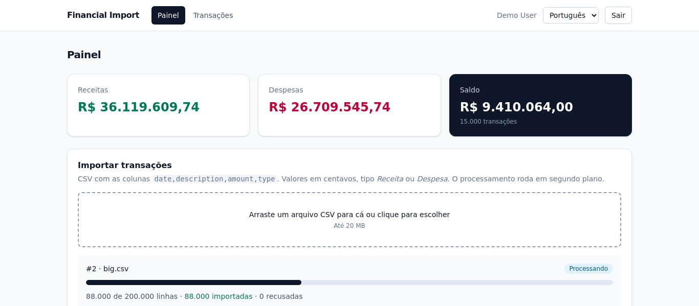
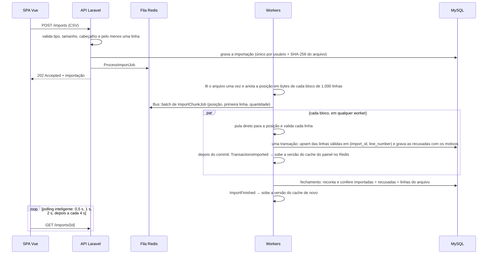

# Financial Import

[English version](README.en.md) · **Português**

[](https://github.com/filipelira1/financial-import/actions/workflows/ci.yml)

Sistema de importação e gestão financeira a partir de CSV. Uma **API REST em Laravel 13** recebe o
arquivo, uma **fila** valida e grava os dados em blocos paralelos, e uma **SPA em Vue 3** mostra o
progresso do envio, um painel em cache com receitas, despesas e saldo, e a lista paginada das transações.

| Painel depois de importar o arquivo fornecido | Importação de 200 mil linhas em andamento |
|---|---|
|  |  |

- **Para começar:** `make up`, depois abra <http://localhost:8090> e entre com `demo@example.com` / `password`.
- **Idioma:** a interface abre em português; o seletor no topo troca para inglês (a escolha fica guardada no navegador).
- **Testes:** `make test` (backend), `make test-frontend` (frontend) e `make smoke` (ponta a ponta).
- **Documentação da API:** <http://localhost:8090/docs/api>, ou importe [`docs/openapi.json`](docs/openapi.json) no Postman ou no Insomnia.

> O código, os nomes, os commits e a documentação da API estão em inglês, como pede o enunciado. A interface e as
> mensagens da API seguem o idioma escolhido (português ou inglês). Este README está em português; a versão em
> inglês é o [`README.en.md`](README.en.md).

## Requisito → onde está → prova

| Requisito | Onde está | Prova |
|---|---|---|
| API RESTful isolada, Laravel 9+ | Laravel 13, [`routes/api.php`](backend/routes/api.php) em `/api/v1` | [`docs/openapi.json`](docs/openapi.json); a CI confere que ele bate com o código |
| API e SPA só para usuários autenticados | Token Bearer do Sanctum ([`AuthController`](backend/app/Http/Controllers/Api/V1/AuthController.php)); guarda de rota na SPA ([`router.ts`](frontend/src/router.ts)) | [`AuthenticationTest`](backend/tests/Feature/Auth/AuthenticationTest.php); `requires a token on every import endpoint` em [`ImportApiTest`](backend/tests/Feature/Imports/ImportApiTest.php) |
| Envio do CSV, leitura, validação e gravação em segundo plano | [`StartImportAction`](backend/app/Application/Import/StartImportAction.php), [`ProcessImportJob`](backend/app/Jobs/ProcessImportJob.php), [`ImportChunkJob`](backend/app/Jobs/ImportChunkJob.php), [`TransactionRowParser`](backend/app/Domain/Import/TransactionRowParser.php), [`CsvReader`](backend/app/Infrastructure/Csv/CsvReader.php) | [`ImportProcessingTest`](backend/tests/Feature/Imports/ImportProcessingTest.php) (arquivos sujos, idempotência), [`RealFileAcceptanceTest`](backend/tests/Feature/Imports/RealFileAcceptanceTest.php) (15 mil linhas, totais exatos), `make smoke` |
| Job despachado no envio | `ProcessImportJob` na fila `imports`, depois um `Bus::batch` de blocos | `Queue::assertPushedOn` em `ImportApiTest`; `Bus::assertBatched` em `ImportProcessingTest` |
| Painel em cache (receitas, despesas, saldo), invalidado por eventos/observers | [`GetDashboardSummaryAction`](backend/app/Application/Finance/GetDashboardSummaryAction.php), [`DashboardSummaryCache`](backend/app/Infrastructure/Cache/DashboardSummaryCache.php), [`InvalidateDashboardSummary`](backend/app/Listeners/InvalidateDashboardSummary.php), [`TransactionObserver`](backend/app/Observers/TransactionObserver.php) | [`DashboardSummaryTest`](backend/tests/Feature/Dashboard/DashboardSummaryTest.php), rodando no Redis de verdade |
| Despesa nunca soma como receita | [`FinancialSummary`](backend/app/Domain/Finance/FinancialSummary.php) (a única regra de saldo), restrições `CHECK` na [migration](backend/database/migrations/2026_11_24_100001_create_transactions_table.php) | [`FinancialSummaryTest`](backend/tests/Unit/Domain/FinancialSummaryTest.php), `never counts an expense as income` (painel e importação), [`TransactionConstraintsTest`](backend/tests/Feature/Database/TransactionConstraintsTest.php) |
| Vue: lista paginada e envio com retorno visual | [`TransactionsView`](frontend/src/views/TransactionsView.vue), [`ImportPanel`](frontend/src/components/ImportPanel.vue), [`usePolling`](frontend/src/composables/usePolling.ts) | Vitest ([`usePolling.test.ts`](frontend/src/composables/usePolling.test.ts), [`useImportTracker.test.ts`](frontend/src/composables/useImportTracker.test.ts)); capturas acima |
| Docker Compose: app, MySQL, Redis, worker | [`docker-compose.yml`](docker-compose.yml) (mais nginx e scheduler) | O job `stack` da CI sobe tudo do zero e importa o arquivo real |
| Testes com Pest ou PHPUnit | Pest 5 (backend), Vitest (frontend) | `make test`, `make test-frontend`, [CI](.github/workflows/ci.yml) |
| Extra: DDD, SOLID, Actions/Services/Repositories, controllers finos | `app/Domain`, `app/Application`, `app/Infrastructure` ([Arquitetura](#arquitetura)) | [`ArchitectureTest`](backend/tests/Unit/ArchitectureTest.php) |
| Extra: documentação da API | Scramble (gerada a partir do código) | <http://localhost:8090/docs/api>, `docs/openapi.json` |
| Extra: CI rodando os testes | [GitHub Actions](.github/workflows/ci.yml): backend, frontend, pilha completa | Selo no topo |
| Extra: aviso quando o processamento termina | Polling inteligente (intervalo crescente, pausa com a aba escondida); evento `ImportFinished` pronto para WebSockets | `usePolling.test.ts` |
| Extra: tudo em inglês | Código, commits e documentação da API em inglês; interface e mensagens da API em português ou inglês ([`i18n/`](frontend/src/i18n), [`SetLocaleFromHeader`](backend/app/Http/Middleware/SetLocaleFromHeader.php)) | [`i18n.test.ts`](frontend/src/i18n/i18n.test.ts), [`LocalizationTest`](backend/tests/Feature/Http/LocalizationTest.php) |

---

## Sumário

1. [Como subir](#como-subir)
2. [Como rodar os testes](#como-rodar-os-testes)
3. [O que roda em cada serviço](#o-que-roda-em-cada-serviço)
4. [API](#api)
5. [Como uma importação funciona](#como-uma-importação-funciona)
6. [Regras da importação](#regras-da-importação)
7. [Arquitetura](#arquitetura)
8. [Padrões de projeto](#padrões-de-projeto)
9. [Decisões técnicas](#decisões-técnicas)
10. [Desempenho medido](#desempenho-medido)
11. [Limites e próximos passos](#limites-e-próximos-passos)
12. [Problemas comuns](#problemas-comuns)

---

## Como subir

**Pré-requisitos:** Docker com Compose v2. O `make` é opcional. As portas **8090** e **127.0.0.1:33070** precisam estar livres.

```bash
git clone https://github.com/filipelira1/financial-import.git
cd financial-import
make up
```

Sem `make`:

```bash
HOST_UID=$(id -u) HOST_GID=$(id -g) docker compose up -d --build --wait
```

A primeira subida gera as imagens, instala as dependências do PHP, roda as migrations e cria o usuário de
demonstração. Levou **2 min 41 s** numa máquina limpa da CI do GitHub; as próximas levam segundos. Depois:

1. Abra <http://localhost:8090> e entre com **`demo@example.com` / `password`**.
2. Arraste [`backend/tests/fixtures/financial_transactions.csv`](backend/tests/fixtures/financial_transactions.csv)
   (o arquivo fornecido no enunciado) para a área de envio.
3. Acompanhe a barra de progresso. O painel deve terminar em **receitas R$ 36.119.609,74**,
   **despesas R$ 26.709.545,74** e **saldo R$ 9.410.064,00** (15.000 transações).

`make help` lista todos os atalhos. `make down` para a pilha. `make fresh` esvazia o banco (mantendo o
usuário de demonstração).

## Como rodar os testes

| Comando | O que roda |
|---|---|
| `make test` | **Backend:** Pest no MySQL 8.4 (schema separado `financial_import_test`), com os testes do painel no Redis de verdade (banco 15): unidade, feature, um teste de aceitação com o arquivo real de 15 mil linhas e testes de arquitetura. |
| `make test-frontend` | **Frontend:** type-check e Vitest, num container Node descartável (não precisa de Node.js na máquina). Com Node 22 instalado: `cd frontend && npm ci && npm test`. |
| `make smoke` | **Ponta a ponta, contra a pilha no ar:** entra, importa o CSV fornecido pela API, espera a fila e compara o painel com os totais esperados. |
| `make lint` | Pint (estilo do código). |

As mesmas conferências rodam no [GitHub Actions](.github/workflows/ci.yml) a cada push:
- **backend:** Pint, Pest com MySQL e Redis de serviço, e a conferência de que o `docs/openapi.json` bate com o código;
- **frontend:** type-check, Vitest e o build de produção;
- **stack:** `docker compose up` exatamente como acima, seguido do teste ponta a ponta.

## O que roda em cada serviço

| Serviço | Papel |
|---|---|
| `nginx` | Entrega a SPA em Vue (gerada dentro da imagem) e repassa `/api`, `/docs` e `/up` ao PHP. Porta **8090**. |
| `app` | PHP-FPM 8.4 com Laravel 13. Ao subir, instala dependências, roda migrations e seed; o healthcheck consulta o próprio PHP-FPM. |
| `worker` | `queue:work` no Redis (fila `imports` primeiro). Para escalar: `docker compose up -d --scale worker=3`. |
| `scheduler` | `schedule:work`: apaga tokens vencidos, recupera importações travadas e descarta importações falhas que nunca foram repetidas. |
| `mysql` | MySQL 8.4 (dados e schema de teste). Exposto só em `127.0.0.1:33070`. |
| `redis` | Redis 7.4: fila, cache, limites de tentativa e travas. Não exposto. |

## API

Todas as rotas ficam em `/api/v1`, respondem JSON e, exceto o login, exigem `Authorization: Bearer <token>`.
- **Documentação interativa**, gerada do código pelo Scramble: **<http://localhost:8090/docs/api>**. A página
  só abre com `APP_ENV=local`, o padrão do `.env.example`.
- **O mesmo documento OpenAPI** está em [`docs/openapi.json`](docs/openapi.json), pronto para importar no
  Postman ou no Insomnia. `make docs` gera de novo.

| Método | Caminho | Descrição |
|---|---|---|
| `POST` | `/auth/login` | E-mail e senha em troca de um token (vence em 8 h). Limite de tentativas por conta e por IP. |
| `POST` | `/auth/logout` | Revoga o token atual. |
| `GET` | `/auth/me` | O usuário autenticado. |
| `POST` | `/imports` | Envia um CSV (`multipart/form-data`, campo `file`). Responde **202** na hora com a importação; **409** se o mesmo arquivo já foi enviado; **422** para arquivo ou cabeçalho errado. |
| `GET` | `/imports` | As importações do usuário, da mais nova para a mais antiga. |
| `GET` | `/imports/{id}` | Situação e progresso (`progress` de 0 a 100, `is_finished`), para o polling. |
| `GET` | `/imports/{id}/failures` | Linhas recusadas: número da linha, conteúdo e motivos. |
| `POST` | `/imports/{id}/retry` | Roda de novo uma importação que falhou (**409** se ela não falhou). Linhas já gravadas não duplicam. |
| `GET` | `/dashboard/summary` | `income_cents`, `expense_cents`, `balance_cents`, `transaction_count` (em cache). |
| `GET` | `/transactions` | Lista paginada, da mais nova para a mais antiga. Filtros: `type`, `from`, `to` (`YYYY-MM-DD`), `per_page` (5 a 100), `page`. |

A importação de outro usuário responde **404**, igual a uma que não existe. **Valores são centavos
inteiros** (`115346` = R$ 1.153,46).

```bash
TOKEN=$(curl -s -X POST localhost:8090/api/v1/auth/login -H 'Content-Type: application/json' \
  -d '{"email":"demo@example.com","password":"password"}' | jq -r .data.token)

curl -s -X POST localhost:8090/api/v1/imports -H "Authorization: Bearer $TOKEN" -H 'Accept: application/json' \
  -F file=@backend/tests/fixtures/financial_transactions.csv
curl -s localhost:8090/api/v1/dashboard/summary -H "Authorization: Bearer $TOKEN"
```

## Como uma importação funciona



## Regras da importação

- **Cabeçalho:** `date`, `description`, `amount` e `type`, em qualquer ordem e com maiúsculas ou minúsculas. Colunas a mais são ignoradas.
- **Arquivo:** UTF-8 ou Windows-1252 (Latin-1); separador vírgula, ponto e vírgula ou tab; BOM e CRLF são aceitos; até 20 MB.
- **`date`:** `YYYY-MM-DD` e uma data que existe no calendário (`2025-02-30` é recusada).
- **`description`:** obrigatória, até 255 caracteres.
- **`amount`:** **inteiro positivo em centavos**. Sem sinal, separador ou casas decimais: `-500`, `1.234,56` e `12.5`
  são recusados, em vez de adivinhados.
- **`type`:** `Receita` → income, `Despesa` → expense (também `income` / `expense`), com maiúsculas ou minúsculas.
- **Linhas em branco** são puladas. O número da linha é o do arquivo, e o cabeçalho é a linha 1.
- **Linhas inválidas** não param a importação. As válidas são gravadas, cada linha recusada fica guardada com
  todos os motivos, e a importação termina como `completed_with_errors`.
- **O mesmo arquivo** (mesmo SHA-256) enviado duas vezes pelo mesmo usuário responde **409**.

Situações possíveis: `pending` → `processing` → `completed` | `completed_with_errors` | `failed`.

## Arquitetura

```
backend/app
├── Domain/                 PHP puro, sem framework (garantido por tests/Unit/ArchitectureTest.php)
│   ├── Finance/            TransactionType, TransactionData, FinancialSummary (a regra de saldo),
│   │                       TransactionRepository (porta), evento TransactionsImported
│   └── Import/             ImportStatus, TransactionRowParser (regras de validação), RowRejection, ImportFinished
├── Application/            casos de uso (Actions): StartImport, PlanImport, ImportChunk, FinalizeImport,
│                           RetryImport, RecoverStuckImports, DiscardFailedImports, GetDashboardSummary,
│                           ListTransactions
├── Infrastructure/         CsvReader (leitura em streaming, posições em bytes), DbTransactionRepository
│                           (upsert em lote, somas), DashboardSummaryCache (chaves com versão)
├── Http/                   controllers finos, FormRequests, API Resources
├── Jobs/                   ProcessImportJob (planeja e distribui), ImportChunkJob (um bloco)
├── Listeners/, Observers/  invalidação do cache do painel
└── Models/                 models Eloquent (persistência)

frontend/src
├── api/                    cliente fetch (Bearer, erros tipados), rotas
├── composables/            usePolling (polling inteligente), useImportTracker
├── stores/                 sessão (Pinia)
├── components/, views/     painel, área de envio, transações
└── types/api.ts            o contrato da API (espelha os Resources do Laravel)
```

Os testes de arquitetura (Pest `arch()`) garantem quatro regras:
- o domínio não usa nada do Laravel, dos models, do HTTP nem da infraestrutura;
- eventos e objetos de dados do domínio são `final readonly`;
- os casos de uso não conhecem HTTP;
- os controllers não fazem consulta nem despacham job.

## Padrões de projeto

| Padrão | Onde | Por que aqui |
|---|---|---|
| **Action / caso de uso** | `app/Application/*Action.php` | Uma classe por caso de uso. Controllers, jobs e comandos só traduzem a entrada e chamam a Action, então o mesmo caso de uso serve HTTP, fila e linha de comando. |
| **Repository (porta e adaptador)** | Porta: `Domain/Finance/Contracts/TransactionRepository`; adaptador: `Infrastructure/Persistence/DbTransactionRepository` | Só onde a consulta é o ponto central: o upsert em lote e a soma. Leituras simples usam o Eloquent direto, porque um repository na frente de cada model seria cerimônia. |
| **Evento de domínio + listener** | `TransactionsImported`, `ImportFinished` → `InvalidateDashboardSummary` | O upsert em lote passa por fora do Eloquent, então um observer do model não vê as linhas importadas. A importação avisa. |
| **Observer** | `TransactionObserver` | Cobre transações gravadas uma a uma pelo Eloquent (um seeder, o tinker, uma futura rota de lançamento manual). Testado por `is refreshed when a single transaction is saved or deleted` em [`DashboardSummaryTest.php:131`](backend/tests/Feature/Dashboard/DashboardSummaryTest.php#L131). |
| **DTO / Value Object** | `TransactionData` (uma linha validada), `FinancialSummary` (totais e a regra de saldo), `CsvChunk` (o conteúdo do job) | Imutáveis (`final readonly`), então a validade é conferida uma vez, no construtor. |
| **Enum** | `TransactionType`, `ImportStatus` | Conjuntos fechados de valores, convertidos nos models e garantidos por restrições `CHECK`. |
| **Batch / fan-out** | `ProcessImportJob` → `Bus::batch(ImportChunkJob…)` → `finally` | Blocos em paralelo, com progresso e um único passo de fechamento. |

Além dos padrões:
- **Eventos depois do commit, por convenção:** os eventos são disparados com `DB::afterCommit()` no ponto de
  disparo, e não com `ShouldDispatchAfterCommit` no evento, porque os eventos de domínio continuam PHP puro
  (o teste de arquitetura proíbe Laravel no domínio). A garantia é a mesma: os listeners só veem linhas já
  gravadas, mesmo que quem chama envolva o caso de uso numa transação própria.
- **Models estritos em desenvolvimento:** `Model::shouldBeStrict()` faz consultas N+1 e atributos descartados
  em silêncio falharem de forma visível fora da produção.

## Decisões técnicas

**1. Dinheiro é um número inteiro de centavos.**
- **Decisão:** um `BIGINT` sempre positivo. O sinal vem do `type`, e a regra de saldo (`receitas − despesas`)
  fica num lugar só, o `FinancialSummary`.
- **Por quê:** float perde centavos. O arquivo fornecido só tem inteiros de 5001 a 1499842, então centavos é a
  única leitura sem ambiguidade.
- **Proteção no banco:** `CHECK (type IN ('income','expense'))` e `CHECK (amount_cents > 0)`.

**2. A fila leva um endereço, não os dados.**
- **Decisão:** o `ProcessImportJob` lê o arquivo uma vez e anota a posição em bytes onde começa cada bloco de
  1.000 linhas. Cada `ImportChunkJob` pula direto para lá.
- **Por quê:** o Redis guarda três números por job, e a memória do worker é a mesma para 15 mil ou 15 milhões
  de linhas. Os blocos rodam num `Bus::batch` (progresso, `allowFailures`, `finally`), então mais workers
  significam mais blocos em paralelo.

**3. Idempotência em dois níveis.**
- **Arquivo:** índice único em `(user_id, file_hash)`. Dois envios iguais ao mesmo tempo são resolvidos pelo
  banco, e o segundo recebe 409.
- **Linha:** índice único em `(import_id, line_number)` mais upsert. A fila entrega pelo menos uma vez, então
  um bloco que roda duas vezes (por exemplo, o worker caiu depois do commit) não grava nada novo, e os
  contadores só crescem com as linhas gravadas de verdade.
- **Por que não `INSERT IGNORE`:** no MySQL ele também transformaria erros reais (truncamento, `CHECK`, chave
  estrangeira) em simples avisos.
- **Ressalva:** no MySQL, o upsert sem mudança conta 0 linhas afetadas e vale para qualquer chave única, o que
  é seguro aqui porque essa é a única da tabela. No PostgreSQL, o equivalente seria `ON CONFLICT DO NOTHING`.

**4. Importação parcial com relatório, mais uma conferência de contagem.**
- **Decisão:** uma linha ruim vira uma recusa relatada, não um arquivo inteiro com falha. Quando o batch
  termina, a importação é recontada a partir das tabelas e só conclui se `importadas + recusadas = linhas do
  arquivo`. Se não bater, ela falha com o motivo e pode ser repetida sem duplicar.
- **Por quê:** recusar 14.999 linhas boas por causa de uma linha ruim desperdiça o trabalho do usuário.

**5. Cache do painel com versão na chave.**
- **Decisão:** a chave é `dashboard:summary:{user}:v{version}`, e invalidar é subir a versão.
- **Por que não apagar a chave:** uma leitura que começou antes do commit de uma importação poderia gravar os
  totais antigos logo depois do apagamento. Com a versão, essa gravação atrasada cai numa chave que ninguém lê.
- **O que invalida:** os eventos de domínio e o observer descritos acima. TTL de uma hora como rede de segurança.
- **O que calcula:** uma consulta de soma sobre um índice que cobre a consulta. O cache guarda um array
  simples, porque o Laravel 13 se recusa a desserializar objetos do cache. Os testes do painel rodam no Redis de
  verdade: o store em memória (array) esconderia essa armadilha (conferido: guardar o objeto falha ali com
  `__PHP_Incomplete_Class`).

**6. Contadores fora da transação do bloco (um deadlock achado medindo).**
- **O problema:** com três workers, importações falharam: 3 de 15 blocos esgotaram as tentativas por deadlock.
  Inserir uma transação pega uma trava compartilhada na linha da importação (conferência da chave
  estrangeira), e atualizar os contadores dessa linha na mesma transação pede uma trava exclusiva. Dois blocos
  fazendo commit juntos ficam esperando um pelo outro.
- **A correção:** os contadores só alimentam a barra de progresso, então são atualizados depois do commit, e o
  fechamento reconta a partir das tabelas. A transação do bloco também se repete sozinha em caso de deadlock.
- **Resultado:** 0 deadlocks (métricas do InnoDB) e 0 jobs com falha com três workers.

**7. Autenticação por token para uma SPA realmente separada.**
- **Tokens:** token Bearer do Sanctum (8 h), sem cair para sessão. A SPA é servida no mesmo endereço da API,
  então não há CORS.
- **Login:** a conferência da senha roda no timebox do Laravel, então um e-mail que não existe e uma senha
  errada levam o mesmo tempo e recebem a mesma mensagem. As tentativas têm limite por conta e por IP.
- **Onde o token fica no navegador:** no `sessionStorage` (por aba, some quando o navegador fecha).
- **CSP:** a SPA sai com uma Content-Security-Policy estrita (`script-src 'self'`, `connect-src 'self'`), que
  reduz o impacto de um XSS.

**8. Polling inteligente em vez de WebSockets.**
- **Decisão:** a importação termina uma vez só, então a SPA consulta com intervalo crescente (0,5 s, 1 s, 2 s,
  depois a cada 4 s). O polling para sozinho, faz pausa enquanto a aba está escondida e, depois de falhas
  seguidas, avisa que a conexão caiu e oferece retomar.
- **Troca:** nenhum servidor de WebSocket para manter. O Laravel Reverb é o próximo passo natural, e o evento
  `ImportFinished` já existe.

**9. Testes no MySQL (e no Redis), não no SQLite.**
- **Por quê:** somas, upserts, restrições `CHECK` e travas se comportam diferente entre bancos, e o mesmo vale
  para os stores de cache.
- **Como:** os testes usam um schema separado no mesmo MySQL 8.4 e o banco 15 do Redis, e a CI usa MySQL e
  Redis como serviços. Um teste de aceitação importa o arquivo real de 15 mil linhas e confere os totais.

**10. Páginas profundas lidas do índice (deferred join).**
- **Ordem:** a lista é ordenada por `(occurred_on DESC, id DESC)`. O desempate pelo `id` impede que as páginas
  se embaralhem.
- **Deferred join:** com `OFFSET` simples, o MySQL lia e descartava todas as linhas antes da página (página
  751: 68 ms). Agora os ids da página saem do índice `(user_id, occurred_on, id)` (ou
  `(user_id, type, occurred_on, id)` com filtro de tipo), e só essas linhas são lidas: 4 ms.
- **O que falta:** cada página ainda custa um `COUNT(*)` sobre as linhas do usuário, que o "página N de M"
  precisa. Com milhões de linhas, a paginação por cursor (sem total e sem pular para a página N) seria o caminho.

**11. Operação.**
- **Agendador:** tokens vencidos são apagados. Uma importação sem progresso há uma hora vira falha para poder
  ser repetida (cada bloco atualiza o `updated_at`). Uma importação falha que não foi repetida em 7 dias é
  descartada com o arquivo e as linhas parciais, e então pode ser enviada de novo.
- **Arquivos enviados:** o arquivo é apagado assim que as linhas dele são gravadas.

**12. Interface em português e em inglês.**
- **Decisão:** a SPA abre em português e tem um seletor de idioma no topo. Os textos ficam num dicionário
  tipado ([`frontend/src/i18n`](frontend/src/i18n)): uma chave que falta ou um parâmetro errado quebra o
  type-check, sem dependência nova.
- **API:** a SPA manda `Accept-Language`, e o middleware `SetLocaleFromHeader` responde validação, 404 e 409 no
  mesmo idioma (sem o cabeçalho, inglês). Os textos ficam em `backend/lang/pt_BR`.
- **O que a fila grava fica em inglês:** os motivos de recusa e de falha são gravados uma vez, em inglês, para
  o banco e os logs não dependerem de quem enviou. A SPA traduz os motivos conhecidos na hora de mostrar
  ([`reasons.ts`](frontend/src/i18n/reasons.ts)).
- **Valores:** sempre em reais; só os separadores mudam com o idioma.

**13. Um comando para subir.**
- **Decisão:** o container `app` instala as dependências, roda as migrations e o seed ao subir, e o worker, o
  scheduler e o nginx esperam o healthcheck dele.
- **Em produção:** as migrations seriam um passo da publicação, não da subida do container.

## Desempenho medido

Notebook, Docker no WSL2. Cada linha diz como reproduzir.

| O quê | Resultado | Como |
|---|---|---|
| Primeiro `make up` numa máquina limpa | 2 min 41 s | Job "Full stack" da CI (máquina do GitHub, sem cache) |
| Resposta do envio (202) | 0,08 a 0,24 s | `curl -w '%{time_total}'` no `POST /api/v1/imports` |
| Arquivo fornecido (15 mil linhas), 1 worker | 1,6 a 3,0 s, ~90 ms por bloco de 1.000 linhas | `make fresh && make smoke` (mostra o tempo); `make logs` mostra `import.chunk … "ms"` |
| Arquivo fornecido, 3 workers | 1,1 a 2,7 s, 0 deadlocks, 0 jobs com falha | `docker compose up -d --scale worker=3 --no-recreate`, depois o mesmo |
| 200 mil linhas, 1 worker × 3 workers | 47 s × 33 s | O mesmo, com um arquivo maior gerado |
| Resumo do painel | 54 ms com o cache frio, 21 ms do cache | `curl -w '%{time_total}'` duas vezes no `GET /api/v1/dashboard/summary` |
| Consulta do painel | Leitura só do índice: as 15.004 linhas vêm do índice, 8 ms no total | `EXPLAIN ANALYZE` abaixo |
| Lista de transações, página 751 (offset 15.000) | 68 ms → **4 ms** com o deferred join; rota em 25 ms | `EXPLAIN ANALYZE` abaixo |

```sql
-- Painel: "Covering index lookup on transactions using transactions_user_id_type_amount_cents_index"
EXPLAIN ANALYZE SELECT SUM(CASE WHEN type = 'income' THEN amount_cents ELSE 0 END),
                       SUM(CASE WHEN type = 'expense' THEN amount_cents ELSE 0 END), COUNT(*)
FROM transactions WHERE user_id = 1;

-- Página 751: os ids vêm de "Covering index lookup ... (reverse)", depois 20 buscas pela chave primária
EXPLAIN ANALYZE SELECT transactions.* FROM transactions
INNER JOIN (SELECT id FROM transactions WHERE user_id = 1
            ORDER BY occurred_on DESC, id DESC LIMIT 20 OFFSET 15000) AS page ON page.id = transactions.id
ORDER BY transactions.occurred_on DESC, transactions.id DESC;
```

Rode com `docker compose exec mysql mysql -uapp -psecret financial_import`.

**Como ler os números:**
- **Workers parados acordam na hora:** eles esperam no Redis com uma leitura bloqueante (`block_for`), então um
  bloco novo começa imediatamente, e não depois da espera padrão de 3 segundos.
- **Arquivos pequenos:** com 15 mil linhas, o tempo é quase todo custo fixo (a fila pegar o job, o
  planejamento, o fechamento), então mais workers quase não mudam o resultado.
- **Arquivos grandes:** com 200 mil linhas, três workers baixam de 47 s para 33 s. O que limita o resto é a
  velocidade de escrita do MySQL nesta máquina, não o PHP.

## Limites e próximos passos

- **Linhas repetidas entre arquivos:** o CSV não tem identificador da transação, então dois arquivos
  *diferentes* com linhas em comum são importados os dois. O próximo passo seria um aviso por impressão digital
  da linha, com confirmação do usuário.
- **Armazenamento compartilhado:** os workers dividem um volume local com o arquivo enviado. Com várias
  máquinas, seria S3 (ou outro armazenamento de objetos) com leitura por faixa de bytes em cada bloco.
- **Atualização em tempo real:** hoje é polling. O Reverb transmitiria o `ImportFinished`.
- **Paginação em escala:** paginação por cursor em vez de `COUNT(*)` com número de página.
- **Operação da fila:** uma única instância do Redis. O Horizon traria métricas e balanceamento por fila.

## Problemas comuns

- **Porta em uso:** `APP_PORT=8091 MYSQL_PORT=33071 make up`.
- **Arquivos de outro usuário no Linux:** o `make up` passa o seu ID de usuário para as imagens. Com Compose
  puro, use `HOST_UID=$(id -u) HOST_GID=$(id -g) docker compose up -d --build --wait`.
- **Mudança no código do worker:** `make restart-worker` (os workers guardam o código na memória).
- **Começar de novo com o banco vazio:** `make fresh`.
- **Logs:** `make logs`. Cada bloco registra `import.chunk` com a contagem de linhas e o tempo.
